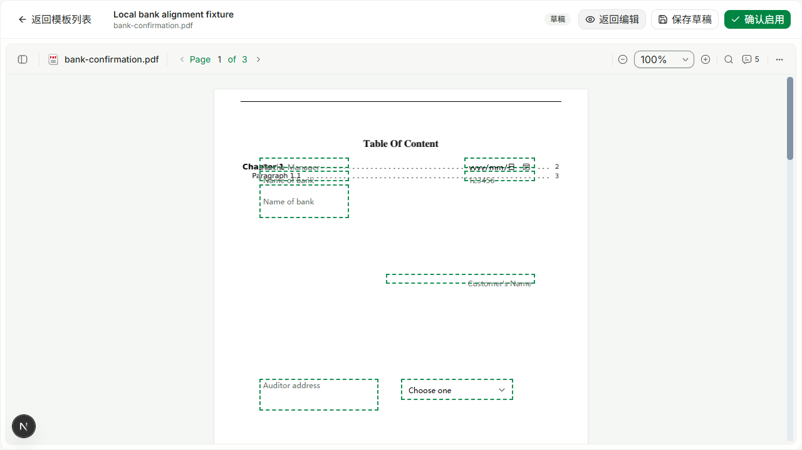
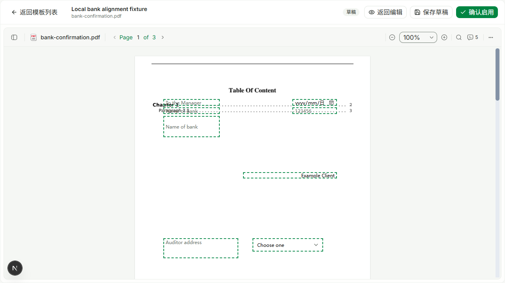

# Confirmation template preview text alignment

## Cause and fix

The editor renders field prompts in vertically centered flex containers. Fill preview put native inline-level inputs in a normal block container. A short PDF field therefore inherited a 24px line box: in the browser reproduction a 16.828px frame placed its 12.828px input 8.578px below the frame top, rather than the 2px border inset. The extra 6.578px displacement put placeholder/value text below the dashed frame.

The fix makes the fill-preview frame a centered flex container. Legacy SELECT triggers also explicitly follow the field height and have no vertical control padding; their normal form-control height must not override small template rectangles. No global Input/Select styles are changed.

There is no schema, coordinate, ID, page, binding, default-value or template-file migration. Existing version-1 PDF/DOCX templates remain usable without moving their fields or resaving them. Server generation/dispatch and stored source documents are unchanged.

## Interactive evidence

Used the actual `ConfirmationTemplateWorkbench` in a temporary local dev harness at `http://127.0.0.1:3042/zh-CN/dev/confirmation-alignment`, with synthetic version-1 fields. The DOCX check loaded the repository's `shinewing-eng-bank-confirmation.docx`. The PDF check loaded the unchanged public [PDF.js basicapi fixture](https://github.com/mozilla/pdf.js/blob/master/test/pdfs/basicapi.pdf). Screenshots show synthetic overlay fields on that fixture, not the user's saved template or a finished confirmation document. The temporary route and copied documents were removed before commit.

Playwright CLI session `template-alignment`, isolated Edge: editor → fill preview → 50%, 100%, 150% zoom → enter `Example Client` in the right-aligned field. Text/date/number control centers matched their field centers at all measured zooms. Final SELECT control height at 100% was 29.672px inside a 33.672px frame, with zero center displacement. Typed content retained right alignment and zero center displacement. DOCX preview was also exercised; no live backend/template was edited or saved.

Before:

After, including an entered preview-only value:

## Validation

Commands run in the isolated `confirmation-preview-text-alignment` worktree:

- `corepack pnpm install --filter @project-wing/emp... --frozen-lockfile --ignore-scripts`: passed.
- `corepack pnpm --filter @project-wing/shared build`: passed.
- `corepack pnpm --filter @project-wing/emp test src/components/confirmations/confirmation-template-workbench.test.tsx -t 'previews filling without' --reporter=dot`: new layout assertion failed on the original implementation, as expected.
- `corepack pnpm --filter @project-wing/emp test src/components/confirmations/confirmation-template-workbench.test.tsx src/components/confirmations/confirmation-template-library-preview.test.tsx src/components/confirmations/confirmation-pdf-preview.test.tsx --reporter=dot`: final full rerun passed **106 tests**.
- `corepack pnpm --filter @project-wing/shared test src/confirmation-template-design.spec.ts`: the workspace script expands to its `src` suite; **260 tests / 25 files passed**.
- `corepack pnpm --filter @project-wing/emp lint`: final TypeScript check passed after restoring the required mock argument (the formatter had removed it).
- `corepack pnpm --filter @project-wing/emp test src/components/confirmations/confirmation-template-workbench.test.tsx -t 'keeps legacy|supports Ribbon undo|waits for delayed PDF text blocks again|previews filling without' --reporter=dot`: final targeted rerun passed 5 tests (99 excluded by the filter).
- `git diff --check`: passed.

Compatibility regressions assert unchanged geometry and right alignment across edit/preview, working text/date/number inputs, legacy SELECT visibility, preview values not saving themselves, version-1 IDs/page/bindings surviving a subsequent draft save, and unchanged input template objects. Existing radio, checkbox, multiline, static-text and mask behavior is covered by the retained suite.

An existing zoom-reset fixture replaces its empty text state after 10ms. Its asynchronous user-event click sometimes missed that state; the test now dispatches the synthetic zoom event synchronously and asserts the empty state immediately, retaining the later ready-state and snap-position assertions. No production text-loading logic was changed.

Scoped Ultracite check is not clean: the two existing large workbench files have pre-existing lint/format findings (110 reported diagnostics, none on added lines in a diff-line audit). Unrelated automatic rewrites were reverted to keep the production patch limited to preview layout. No lint baseline or assertion was weakened. Full EMP production build and authenticated production-template acceptance were not run; no deployment is claimed by local validation or PR merge.
