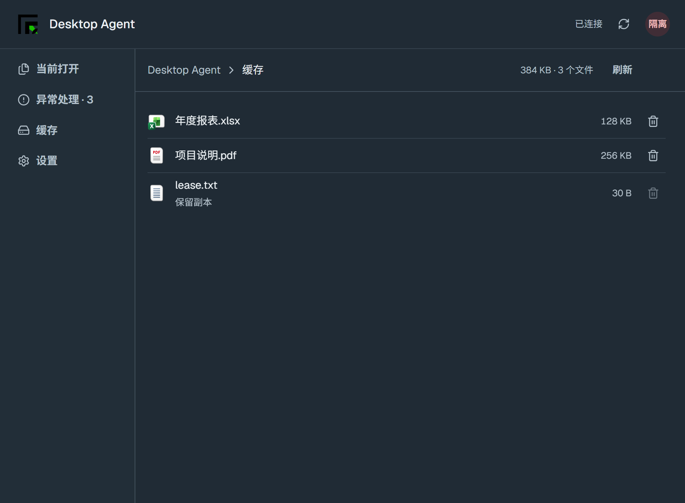
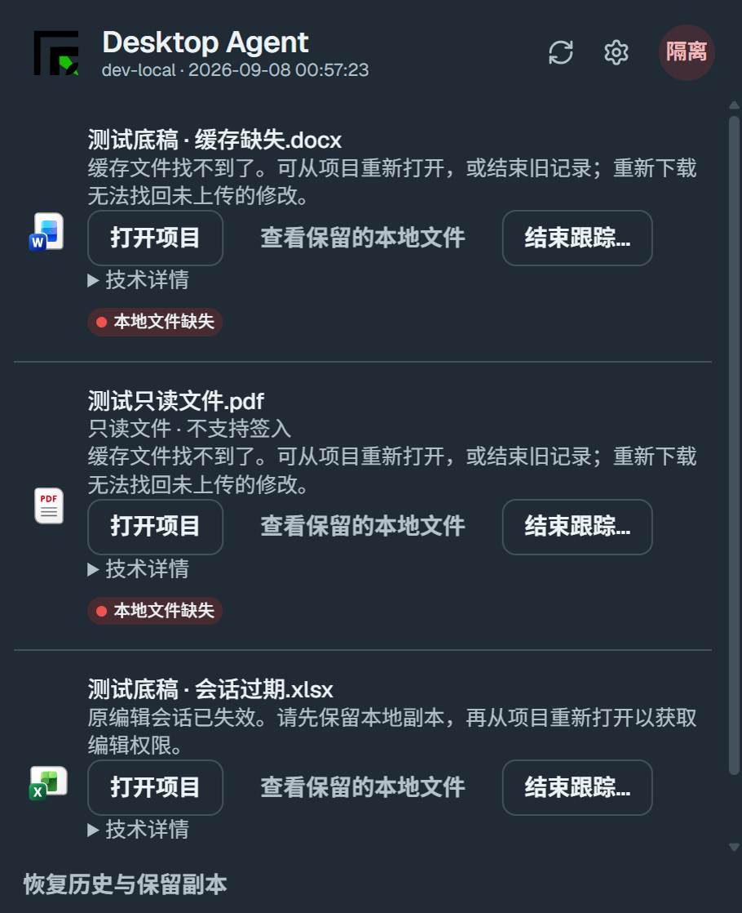

# Desktop Agent resolution and persistent window

## Merge handoff — 2026-09-08

The user explicitly requested **PR and merge first**, superseding the earlier hold for final interactive validation. Latest full checks passed: desktop164 tests with2 opt-in skips; API246 tests; shared settings-shell4 tests; native46 safety scenarios; desktop, API and shared UI typechecks; registry validation; Electron production build; and `git diff --check`. Exact commands are listed in the sections below. Whole-repository boundary audit still reports111 unrelated-file findings; no baseline was changed.

The latest numeric badge, replacement settings and capacity-reduction dialog have automated coverage, but their final integrated manual UI pass is not claimed complete. The earlier Computer Use interruption/minimized-window conflict is disclosed rather than treated as a test pass. No native release, installer application or production file operation is part of this merge request.

Intermediate four-section cache preview (before the subsequent numeric badge/policy refinements):

## Workspace revision requested after the initial implementation

The user requested a restrained web-style sidebar with Open files, Issues, Cache, and Settings. Cache location, capacity and cleanup policy belong to Settings; Cache shows used space and cached files with per-file delete actions. Later feedback requested metadata in the existing header row, higher row density, and a Resolve action that navigates to a dedicated disposition page instead of an empty split pane.

- Reuses the web `SettingsDialogShell`, theme preference cards, tabs, buttons and semantic tokens. The shell gains a backwards-compatible optional `headerActions` slot, shown in the Settings showroom specimen and covered by three shared shell tests; no Ready/whole-system approval flag is changed.
- Cache metadata/refresh and recovery history occupy the contextual header slot. Compact rows use standard spacing and retain control sizes. Resolve opens a separate file-specific page with a back action and focus management.
- Native cache listing returns opaque file ids, sizes and protected reasons. Deletion revalidates the selected identity, the current cache index, active/recovery ownership, and the controlled path. It uses an exclusive delete-on-close handle, never recursively deletes folders, and never changes server originals. Working copies, snapshots and unverified orphan data cannot be deleted as ordinary cache.
- Manual cache changes are confirmed in the trusted main process and revalidated in native code. Six additional isolated scenarios cover ordinary deletion, active protection, newly claimed files, orphan protection, changed ids and read-only disposable copies.
- Latest validation: desktop tests **159 passed / 2 opt-in skipped**, desktop and shared UI typechecks passed, shared settings shell **3 tests passed**, native safety **28 scenarios passed**, and production Electron bundle built successfully. API tests remain the prior **246 passed**, with no subsequent API service changes in this workspace revision.
- `node scripts/design-first/cli.mjs validate-registry` passed. The repository uses its Node validator rather than the skill's absent portable Python script. Whole-repository boundary audit reports **111 existing findings outside the touched Desktop Agent/settings-shell/specimen files**; filtering the audit found no findings in those touched UI files. The baseline was not changed. Full showroom Next build and full web consumer suites were not run.

Final resumed interactive verification is recorded separately below once completed. The UI automation tool was explicitly paused by the user with Escape and resumed only on user request; another minimized-window/input-epoch conflict required the user to restore the test window. Neither event is reported as a successful interaction check.

Latest navigation refinement: the user rejected the middle-dot count separator. Issues now keeps a plain section label with a separate secondary numeric badge aligned at the right of the navigation row; zero counts are hidden and breadcrumbs do not inherit the count. The shared optional badge slot is demonstrated in the Settings specimen. `corepack pnpm --filter @project-wing/ui test src/settings-dialog-shell.test.tsx` passed4 tests; `corepack pnpm --filter @project-wing/desktop-agent-desktop lint` and `corepack pnpm --filter @project-wing/desktop-agent-desktop build` passed. This update has not been merged or installed, and its final live visual check remains pending with the wider workspace verification.

## Behavior

### Silent cache rotation

Capacity reduction is an explicit exception to silent automatic rotation. If a lower limit is below freshly read usage, the trusted host asks for confirmation and shows the selected strategy and minimum reclaim amount. Cancel returns a cancellation result, so the form does not claim a successful save. The native service independently requires confirmation, reserves settings/session state, recalculates actual sizes and protected paths, then cleans eligible copies with the requested strategy before persisting the new limit. Protected data making the target impossible is detected before deletion. Busy-file failures retain the old limit; if some approved disposable copies were already removed, the error explicitly says so. Choosing a different already-full directory is rejected rather than clearing unverified contents there.

Additional validation: `dotnet run --project apps/desktop-agent/runtime/RecoverySafety.Tests --no-restore` passed **46 scenarios**, including7 reduction cases (confirmation required, LRU, newly selected FIFO, protected content, active session, busy files, and no cleanup needed). `corepack pnpm --filter @project-wing/desktop-agent-desktop test src/main/session-resolution-ipc.test.ts` passed11 tests, including cancel/no-persist and confirmed strategy propagation. The native build and desktop typecheck passed. No real capacity was reduced and no real cache was cleared in this verification.

The user approved configurable LRU (default), FIFO, and idle retention (default30 days), and explicitly required automatic expiry/rotation without prompts. Settings persist optional `evictionPolicy` and `idleDays`; older web requests that omit them preserve the current choices. Legacy settings fall back to LRU/30 days. FIFO stores the initial cache timestamp separately from access time; older index entries without that timestamp use their existing access timestamp as a migration baseline. Idle expiry is recomputed against the configured duration when loading the index, so changed retention applies to existing entries too.

Capacity checks reject an oversized incoming file before evicting other cache, including the post-download unknown-length case. Protected work is never a rotation candidate. Periodic expiry silently removes eligible expired copies even when protected files alone exceed capacity; only a real blocked file operation surfaces a capacity error. Cache page refreshes its listing quietly while visible, without rotation toasts or confirmations. Explicit manual deletion retains its own confirmation.

`dotnet run --project apps/desktop-agent/runtime/RecoverySafety.Tests --no-restore` passed **39 isolated scenarios** (28 earlier safety cases and11 replacement cases), including LRU/FIFO order, FIFO hits, expiry, protected-capacity expiry, oversized known/unknown-length rejection, persisted policy, legacy defaults and malformed optional settings. No production cache or file record was altered.

- `LOCAL_FILE_MISSING`, `LEASE_LOST`, and `LOCK_REVOKED` now expose project reopen, retained copies, technical details, and **End tracking**. Technical errors no longer replace the human-readable explanation. Unknown server state remains retryable with support guidance, never silently dismissed.
- End tracking requires a native confirmation (cancel is the default), fresh session validation, and a native operation serialized against synchronization. Available working/snapshot bytes are copied and flushed outside the evictable cache before release; originals are not deleted. Only an explicit server `recoveryEnded` acknowledgement permits active-record removal. A durable recovery receipt is written before that removal; credentials are excluded. Failed copies, network failures, unsupported servers, and concurrent session changes leave the record available for retry.
- Server recovery release checks the exact grant. A verified old grant whose lock has been replaced can finish without touching the new owner's lock. Unknown grants require project support. Writable release persists `RECOVERY_ENDED` and uses the existing audited release transaction. Read-only records have no edit lease to release.
- Windows profile redirection is handled when opening native-confirmed recovery folders. Windows may map the user's C: profile to D:; that is different from accepting a renderer-supplied file path.
- Window uses an opaque standard OS frame with a taskbar entry and native minimization. Blur and Escape no longer hide it. No JavaScript pointermove/setPosition loop is used. Existing content tokens/components are reused according to the small-change design-first path.
- Also includes the previously tested helper-staging fix for in-app update preparation. No migration or cache deletion is required.

## Validation and interactive evidence

Commands, run from the isolated `desktop-agent-recovery` worktree:

- `corepack pnpm --filter @project-wing/desktop-agent-desktop test`: 151 passed, 2 opt-in skipped, including the final three IPC confirmation tests.
- `corepack pnpm --filter @project-wing/desktop-agent-desktop lint`: passed.
- `corepack pnpm --filter @project-wing/desktop-agent-desktop build`: passed.
- `corepack pnpm --filter @project-wing/api test:ci src/workflow/workflow.controller.spec.ts src/workflow/workflow.service.spec.ts src/workflow/zip-master.service.spec.ts`: 246 passed.
- `corepack pnpm --filter @project-wing/api lint`: passed after using the existing typed error-code contract.
- `dotnet run --project apps/desktop-agent/runtime/RecoverySafety.Tests --no-restore`: 22 scenarios passed, including eight new resolution cases (missing/read-only/dirty/network retry/old server/open state/outside cache/concurrent generation change). All use synthetic bytes and independent StateRoot/CacheRoot; no Office or installed Agent is launched.
- `git diff --check`: passed.

Initial API checks were blocked by missing dependencies/generated Prisma client. Scoped frozen-lockfile installation and `prisma generate` with a non-routable synthetic DATABASE_URL fixed the environment; no database connection or migration was performed.

The last native rebuild initially hit a DLL lock held by the interactive fixture, not the installed Agent. After verifying and stopping only that fixture runtime, the final 22-case run passed again. The fixture's quit guard was corrected so its bounded shutdown can complete.

Interactive harness: `apps/desktop-agent-desktop/scripts/resolution-acceptance.ts`, bundled with local esbuild and launched with the existing Electron43.4.1. It loads the actual built renderer/preload and production IPC/runtime client against a separately running .NET Runtime with synthetic device pairing and a loopback-only fixture server. Ports are independently allocated; StateRoot/CacheRoot/profile are unique temporary directories. Manager health identity is fixture-provided; therefore this is NOT production Manager/release acceptance.

Computer Use inspected the live error controls, confirmation content, cancel via Escape, and minimize/restore. Automated mouse dragging did not establish movement reliably, including on an OS caption; this limitation is not reported as a performance pass. The user then explicitly confirmed the native-titlebar test window moved normally and felt responsive. The fixture's recorded bounds changed from `(380,70)` to `(646,76)`. The native frame uses the standard window system, not the initially proposed custom drag region. Reference: [Electron custom window interactions](https://www.electronjs.org/docs/latest/tutorial/custom-window-interactions).

This screenshot shows renderer content; native titlebar/minimization and cancellation are documented in the interactive transcript. It is not a screenshot of the user's six real records. Confirmation's final destructive action was not clicked through Computer Use; confirmed completion and failure/retry are covered by native synthetic tests and IPC tests. No real records, files, locks or installed binaries were changed in this feature work. Fresh editing/permission acquisition uses the existing project website flow; no production editing or timing benchmark was rerun. macOS interaction and a packaged installer upgrade were not run.

## Delivery order

Deploy the API before installing the new Desktop Agent. Its dedicated `/end-tracking` route prevents an older server from interpreting a recovery request as a normal successful check-in. Local validation, PR merge, native publication, installation and production acceptance are distinct milestones. Publishing/installation are not implied by merging this PR.
