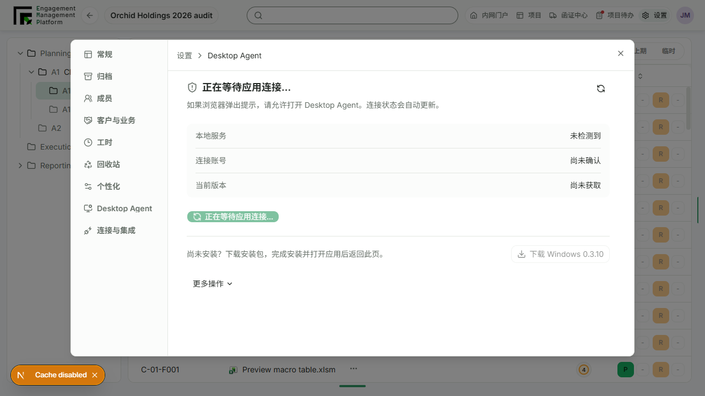
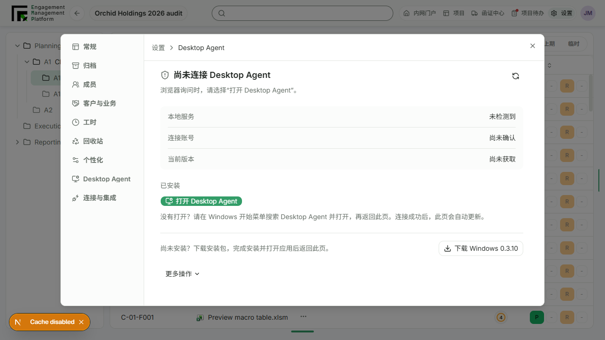
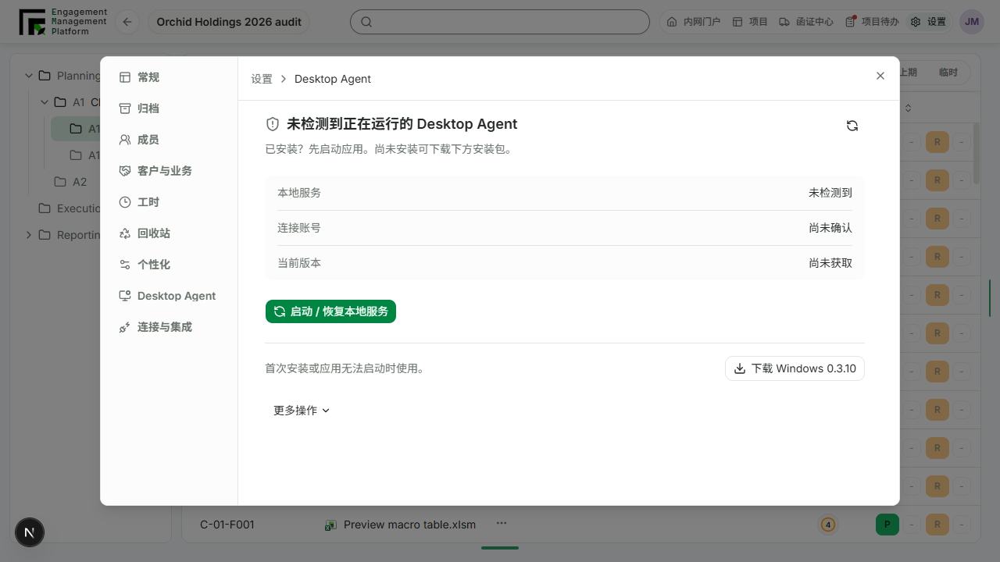
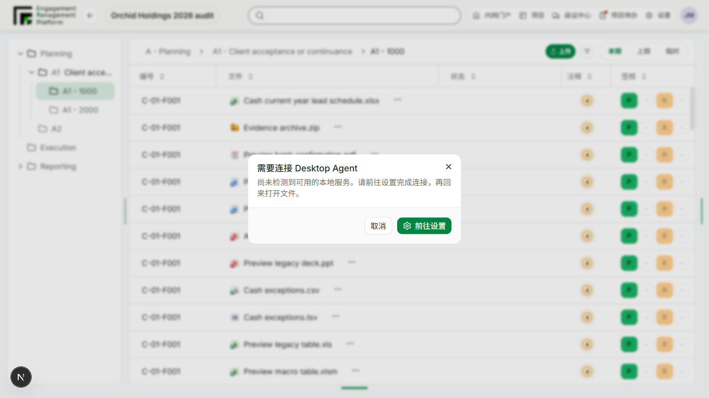
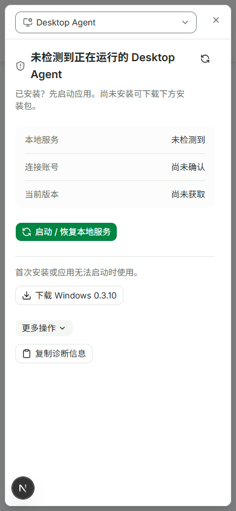

# Desktop Agent settings clarity

## Merge preparation

The user requested PR and merge. Integrated current `origin/main` at `a4fc517b87c1a12e901502ef8997afc9259a80f5` without manual conflict resolution, preserving PR1171's open-request deduplication/performance and native recovery changes, plus the current Smart Form/editor changes. The full workbench regression initially found one stale Smart Form button query (`Close and check in`); main intentionally renamed it `Save as draft` and already updated the dedicated editor test. Only that query was reconciled here; all save/close payload and persistence assertions remain unchanged.

Post-integration checks: `corepack pnpm --filter @project-wing/shared build` and EMP `lint` passed. `corepack pnpm --filter @project-wing/emp test src/api/desktop-agent.test.ts src/components/desktop-agent-settings.test.tsx src/components/desktop-agent-settings-state.test.ts src/components/desktop-agent-settings-prompt.test.tsx src/components/desktop-agent-recovery.test.ts --reporter=dot` passed 88 tests. The final `corepack pnpm --filter @project-wing/emp test src/components/workbench-content.test.tsx --reporter=dot` rerun passed all 186 tests. `corepack pnpm --filter @project-wing/emp test src/components/smart-form-editor.test.tsx src/components/review-note-rich-text.test.tsx --reporter=dot` passed 18 tests. `corepack pnpm --filter @project-wing/emp test src/views/workspace.test.tsx -t 'Desktop Agent settings directly|opens member settings|keeps account details' --reporter=dot` passed 3 targeted tests (65 excluded by the filter). Registry validation passes; the boundary audit still reports 111 pre-existing failure groups, none in touched UI files. No native release or manual deployment is authorized by this UI merge request.

## Follow-up: explicit startup guidance and independent state axes

The user approved separate Open app / Recover service actions and step-by-step browser/start-menu guidance. `desktop-agent-settings-state.ts` now resolves service, account, version and next action independently; the existing combined API `isSupported` contract is not changed. Supported optional updates remain secondary, unavailable account responses remain unknown, and confirmed starting/restoring/updating states do not offer duplicate startup actions. A known update followed by no response has a bounded 60-second restart grace period; it then returns to an explicitly unconfirmed connection state. Historical update failures do not override fresh worker readiness.

Open from an unreachable state requests `projectwing-agent://open`; recovery of a known service failure requests `projectwing-agent://recover`. The page waits for the existing bounded readiness probe and shows browser-permission instructions, followed by Windows Start menu instructions if no connection is confirmed. Old startup errors disappear when fresh service readiness is observed. The lack of a response is never described as proof of non-installation.

Follow-up verification: `corepack pnpm --filter @project-wing/emp test src/components/desktop-agent-settings.test.tsx src/components/desktop-agent-settings-state.test.ts src/components/desktop-agent-settings-prompt.test.tsx src/components/desktop-agent-recovery.test.ts --reporter=dot` passed **42 tests**; `corepack pnpm --filter @project-wing/emp lint` passed. Scoped Ultracite checks and registry validation passed; the boundary audit still has 111 unrelated failure groups with no new settings-file findings.

Playwright CLI session `agent-guidance` exercised the actual mock EMP page at port 3041: settings → Desktop Agent → Open app → waiting state → timeout with Start menu instructions. A test-only DOM interceptor recorded and suppressed the custom-protocol iframe (`projectwing-agent://open`) to avoid launching the real installation. The live release manifest was relayed for the version-labelled download as documented below. The browser did not start, install, repair or pair a real Agent. Windows permission dialogs and authenticated production acceptance remain untested. The prior narrow-layout evidence remains applicable to the shared shell; no new native functionality was added.

## Scope and design

Follow-up interaction captures (before the final minimum button-height refinement):

User requested a clearer EMP Desktop Agent settings page and a short settings handoff instead of the installation wizard when Master opening cannot find Agent. This is an application-specific composition patch using the existing settings shell, semantic colors, Button, Dialog and Collapsible controls. No shared tokens, component API, registry readiness or global design approval was changed.

The page now separates local-service availability, account connection and version. It presents a state-specific primary action, a version-labelled installer download, and collapsed recovery/pairing/diagnostic tools. File attention does not incorrectly label a connected service as unavailable. Unknown account status is not treated as a confirmed signed-out account. Existing Windows-only settings support is unchanged.

For an ordinary Master request with no Agent detected, the short prompt offers Cancel and Go to settings. It closes before dispatching the settings navigation event, which selects Desktop Agent in the existing project settings shell. No installer or recovery operation is started by that prompt, and failed Master requests no longer automatically invoke the native launch protocol. Existing Office-specific blockers, legacy-version/update guidance and read-only workflows are retained.

## Evidence

Local app: `http://127.0.0.1:3041/zh-CN/engagement/project-orchid-2026`, isolated Edge session `agent-settings`, EMP mock project data. Actual exported application components were exercised, not a separate static mockup.

Interactive path: Master-open Cash current year lead schedule.xlsx → short Chinese prompt → Go to settings → settings dialog directly on Desktop Agent → expand More actions. No install, pairing, recovery or diagnostic-copy action was clicked. Desktop 1280×720 and narrow 390×844 layouts were inspected. The initial dev server compile exceeded browser navigation timeout; a subsequent loaded-page check succeeded.

The mock environment initially had no API on localhost:3000, so the release-manifest request failed; the page correctly showed installer-unavailable guidance. For the final download-label check, Playwright routed that single manifest request to the real public EMP release-manifest endpoint and added the local test origin response header. It returned version 0.3.10. This is NOT full backend-attached authenticated project/Agent acceptance. The installed Agent was not used as a failure fixture. Full production login, real pairing/update and deployed acceptance remain unrun.

## Commands and results

- `corepack pnpm install --filter @project-wing/emp... --frozen-lockfile --ignore-scripts`: passed.
- `corepack pnpm --filter @project-wing/shared build`: passed.
- `corepack pnpm --filter @project-wing/emp test src/components/desktop-agent-settings.test.tsx src/components/desktop-agent-settings-prompt.test.tsx src/components/desktop-agent-recovery.test.ts --reporter=dot`: 22 passed, including account-unknown and pending-file recovery coverage.
- `corepack pnpm --filter @project-wing/emp test src/components/workbench-content.test.tsx --reporter=dot`: 186 passed. After the final Master auto-wake removal, the six affected setup/localization tests were rerun with `-t 'directs unavailable|opens settings without|cancels missing|not running instead|omits installer|localized settings'`: 6 passed / 180 excluded by filter.
- `corepack pnpm --filter @project-wing/emp test src/views/workspace.test.tsx -t 'Desktop Agent settings directly|opens member settings|keeps account details' --reporter=dot`: 3 passed / 65 excluded by filter.
- `corepack pnpm --filter @project-wing/emp lint`: final TypeScript check passed after the account-unknown refinement.
- Scoped `corepack pnpm exec ultracite check <nine modified TS/TSX files>` and `corepack pnpm exec oxfmt --config oxfmt.config.ts <modified files>`: formatting/lint issues were corrected and checked.
- `node scripts/design-first/cli.mjs validate-registry`: passed.
- `node scripts/design-first/cli.mjs audit --json`: 111 existing failure groups outside the touched UI files. No baseline was changed. No findings remain for the touched settings, prompt, workbench-paper-section or workspace files.
- `git diff --check`: passed.

Full EMP production build, complete workspace test suite and production/browser-login acceptance were not run. No API/database migration or native installer change is included. The user subsequently authorized PR and merge as recorded above; manual deployment and installed-app changes remain outside this request.
