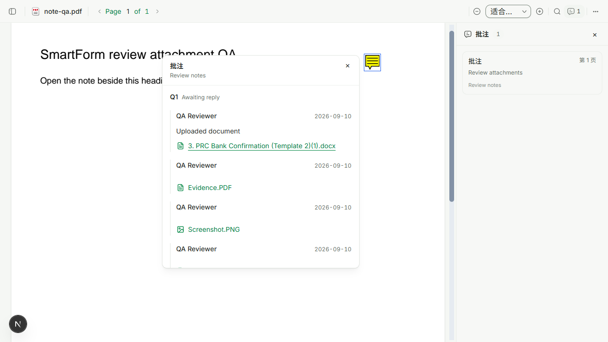
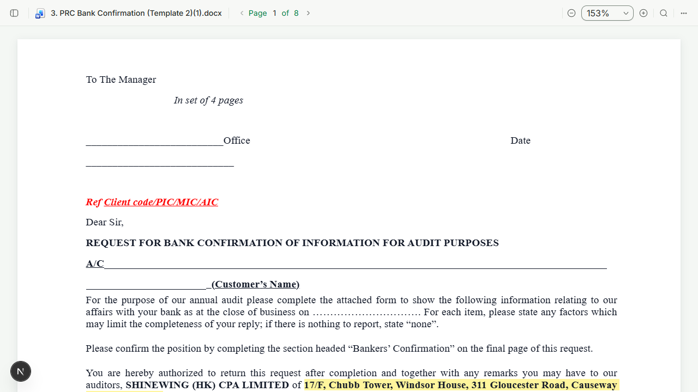

# PDF note attachment classification

## Fix

The historical review-message `images` collection contains arbitrary uploaded files. The PDF annotation renderer treated every member as an image, regardless of filename, and tied the legacy download ID to that incorrect presentation type.

- Classify the original filename's final extension, case-insensitively, instead of trusting the storage collection or rich-text image hint.
- Preserve the monochrome theme-colored icon/name layout. Documents, spreadsheets, presentations and raster images use their respective icon families.
- Keep `review-image:` resource routing independent of file presentation. DOCX, XLSX, PPTX, CSV and PDF use the authorized original bytes with the real filename/type in the existing detached preview.
- Unsupported/unknown review-upload formats download the original rather than being passed to an unrelated viewer. A blocked preview still offers an authorized original download using the correct review endpoint.
- Raster image previews still validate the returned Blob MIME allowlist before constructing an image URL. SVG/HTML are not rendered as inline image documents.
- Existing ordinary attachment PDF-preview and working-paper/link flows remain intact. The PDF/SmartForm viewer uses the same component; no database, stored note, API or PDF metadata migration is required.

## Validation

Commands run from the isolated worktree with bundled Node 24:

```powershell
corepack pnpm install --filter @project-wing/emp... --filter @project-wing/api... --frozen-lockfile --ignore-scripts
corepack pnpm --filter @project-wing/shared build
corepack pnpm --filter @project-wing/emp test src/components/extend/pdf-note-content.test.tsx src/components/extend/pdf-note-file-type.test.ts src/components/detached-attachment-preview.test.tsx src/lib/open-preview-window.test.ts
corepack pnpm --filter @project-wing/emp lint
corepack pnpm exec ultracite check apps/emp/src/components/extend/pdf-note-content.tsx apps/emp/src/components/extend/pdf-note-content.test.tsx apps/emp/src/components/extend/pdf-note-file-type.ts apps/emp/src/components/extend/pdf-note-file-type.test.ts
git diff --check
```

Install/shared build passed. Final focused tests: 43 passed. Tests cover uppercase/double extensions, legacy original-byte routing, incorrect rich-text image hints, MIME rejection, actual image loading/URL cleanup, untrusted project scope, blocked-preview fallback and unsupported-file download. Final EMP typecheck, changed-source ultracite checks and whitespace checks passed. Assertion fingerprint comparison against main found no new volatile assertions in either changed/new test file. Initial test-only type/style issues were corrected, not suppressed.

## Interactive evidence

Playwright CLI, isolated Edge session `note-file-types`, actual EMP PDFViewer at `http://127.0.0.1:3044/zh-CN/dev/pdf-note-files`. A temporary route generated a real PDF with standard Text annotations and the existing version-1 review metadata. Only synthetic project-scoped file responses were used; the route was removed after acceptance.

Verified: annotation metadata round-trip -> popup with document vs image icons -> DOCX click opens the actual DOCX renderer with original filename and visible document text -> PDF click opens PDF renderer -> PNG expands and reports a successfully loaded image -> ZIP emits a successful download with the original filename. No real customer attachments or notes were changed.

The temporary page was removed after these successful checks; Next HMR subsequently reported the removed page until the isolated browser/server were closed. Those cleanup diagnostics are not runtime acceptance failures or a claim of a clean post-cleanup development console.




No backend/database was running locally. Authenticated backend-attached acceptance and live permission checks were not run; existing endpoints and scope boundaries were preserved and exercised with mocked denial/scope tests. No full root test run, production build, native Office launch or deployment verification was performed. This is not a claim of production acceptance.
