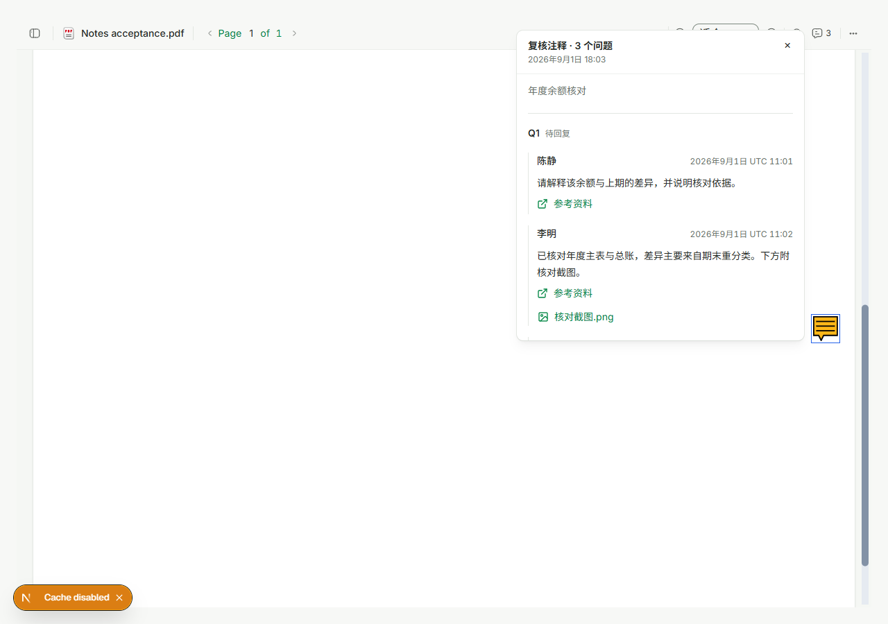
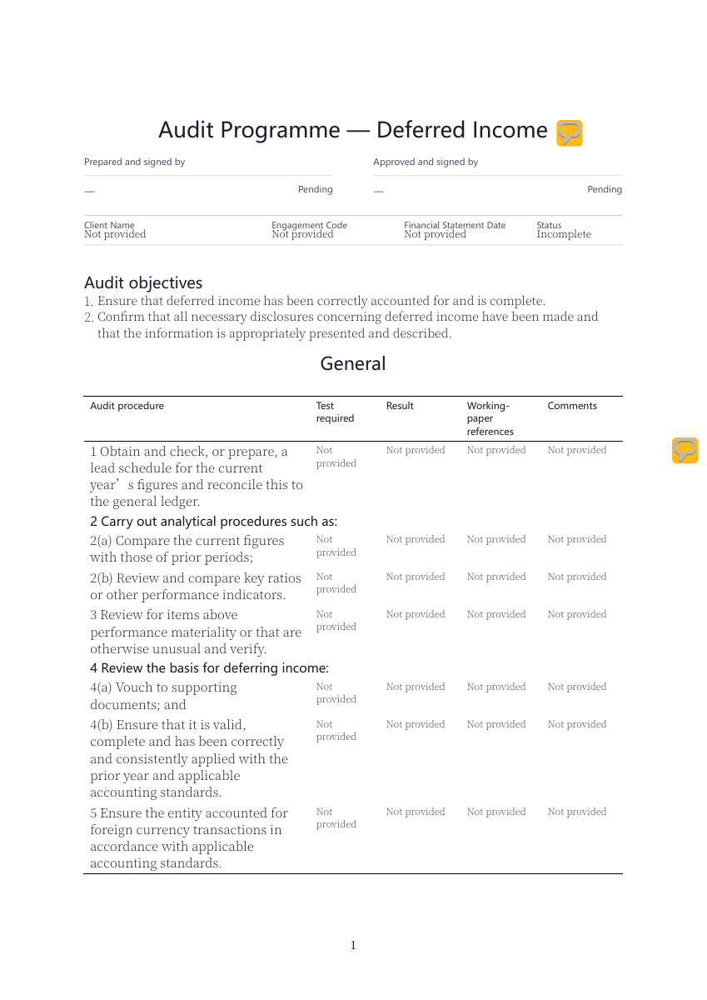
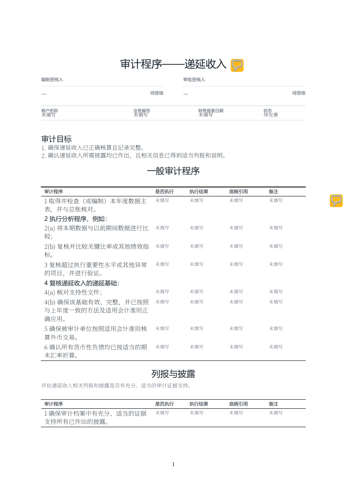

# PDF Notes: formatted content and consistent references

## Scope

Implemented in the existing EMP PDF viewer used by normal attachment previews,
SmartForm cached PDF previews, and authorized detached preview windows. This is a
local implementation on `codex/pdf-rich-notes`; no PR, merge or deployment has been
performed. No saved template/response schema or database migration is required.

## Presentation decisions

The user approved compact, avatar-free conversations and uniform reference rows:

- Q numbers and status separate questions; messages show author and timestamp,
  without added round numbers or visible Question/Reply/Follow-up labels.
- Images, attachments, working-paper references and body links use one icon/name
  shape, 14px text and the same semantic primary color. No thumbnail cards appear
  in the conversation. Images load only after a user clicks their reference.
- Formatting reuses the existing SmartForm and review-note renderers; optional
  rendering callbacks do not change their default behavior elsewhere.
- The existing popover primitive positions comments outside the PDF clipping
  container, avoiding cropped long discussions and narrow-window overflow.
- A failed image request has a retry action. Failed file preview offers an
  explicitly requested original download, still through the authorized API.

The hierarchy borrows semantic-color and boundary concepts from
[Textual's design documentation](https://textual.textualize.io/guide/design/), not
terminal fonts or ASCII decoration. This is a scoped composition change using
existing design primitives, not a global theme/token redesign.

## Data and compatibility

- SmartForm rich-text cells retain readable `/Contents`, standard restricted
  XHTML `/RC`, and versioned `EPDFCustom.projectWingNote` structured content.
- Grouped review questions retain complete `/Contents` and versioned structured
  conversation metadata. Q and message order is chronological with stable ID
  tie-breaking. Partial old histories preserve the original question/legacy reply.
- Third-party PDF readers retain the text fallback. Full interactive reference
  rendering is an application feature; there are no added Notes pages or embedded
  binary attachments. This does not promise rich media in Acrobat's native popup.
- Stored source documents are unchanged. Unknown or malformed rich metadata falls
  back to the existing plain text, with safe web links.
- Project scope comes from the surrounding application/authorized preview handoff,
  never from PDF metadata. Reference identifiers are encoded; existing project and
  review-image authorization endpoints remain responsible for access checks.
- No raw HTML execution, externally embedded image URLs, object-storage keys or
  expiring signed download URLs are added to note metadata. Blob URLs are released
  when image dialogs close/unmount. Executable URL schemes are rejected.
- SmartForm renderer cache version, SmartForm PDF ETag and client PDF URL identity
  invalidate old plain-text preview bytes while retaining versioned-byte caching.

## Local validation

Commands were run from this task's isolated worktree with Node 24.19.0:

- `corepack pnpm install --filter @project-wing/emp... --filter @project-wing/api... --frozen-lockfile --ignore-scripts`: passed.
- `corepack pnpm --filter @project-wing/shared build`: passed.
- `corepack pnpm --filter @project-wing/shared test`: 267 passed.
- `corepack pnpm --filter @project-wing/api test:ci src/smart-forms/smart-form-v2-pdf.service.spec.ts`: 14 passed (actual generated PDFs inspected with pdf-lib; existing Typst rendering tests retained).
- `corepack pnpm --filter @project-wing/api test:ci src/workflow/workflow.service.spec.ts -t buildSmartFormPdfPreviewCacheKey`: 2 passed, 188 excluded by filter.
- `corepack pnpm --filter @project-wing/emp test src/components/extend/pdf-note-content.test.tsx src/components/review-note-rich-text.test.tsx src/components/smart-form-v2-readonly.test.tsx`: 33 passed.
- `corepack pnpm --filter @project-wing/emp test src/components/extend/pdf-note-content.test.tsx src/components/detached-attachment-preview.test.tsx src/components/workbench-cached-preview.test.tsx src/lib/open-preview-window.test.ts src/api/client.test.ts`: final rerun 38 passed.
- `corepack pnpm --filter @project-wing/emp test src/components/extend/pdf-note-content.test.tsx src/components/smart-form-v2-readonly.test.tsx src/components/extend/pdf-viewer-layout.test.ts src/components/extend/pdf-viewer-initial-zoom.test.tsx src/components/extend/pdf-viewer-scroll-area.test.tsx`: 28 passed before the final shared link renderer addition; its renderer regressions were rerun above.
- `corepack pnpm --filter @project-wing/emp lint` and `corepack pnpm --filter @project-wing/api lint`: passed.
- `corepack pnpm exec ultracite check apps/emp/src/components/extend/pdf-note-content.tsx apps/emp/src/components/extend/pdf-note-content.test.tsx packages/shared/src/pdf-rich-note.ts packages/shared/src/pdf-rich-note.spec.ts`: passed.
- Existing registry validator: no errors/warnings. Scoped boundary scan of PDF note,
  viewer and SmartForm renderer: no findings. Including the reused review renderer
  reports its existing `placeholder="https://"` i18n finding; no baseline changed.
- `git diff --check`: passed (Windows line-ending notices only).

Initial checks caught an ESM/Turbopack export mismatch; a dedicated shared-package
subpath fixed it without changing all applications' aliases. A first native preview
window attempt timed out during cold Next compilation; retry after compilation
successfully handed off and rendered the PDF. A test CLI regex containing `|` was
interpreted by the Windows shell; separate targeted invocations passed instead.
Prisma generation used a local dummy DATABASE_URL only to generate types; no
database connection or migration was performed.

## Interactive evidence and limits

Playwright CLI used an independent Edge session against the actual EMP app at
`http://127.0.0.1:3042/zh-CN/dev/pdf-notes`. A temporary test generated a PDF through
the production annotation writer, containing rich Notes, a legacy plain comment,
and 3 Q with 4 messages each. Image/file requests used fixture responses scoped to
the synthetic project; no real customer notes, files or permissions were modified.

Verified the engine's custom-metadata round trip, all 12 messages and the last
message's visibility, safe links, on-demand image dialog, authorized detached PDF
handoff, Escape/close, and 1280px/390px layouts. Browser measurements exposed and
fixed two real issues: clipped popup placement and a global anchor color reset
overriding utility colors. Reference colors are scoped locally; global CSS is intact.

No authenticated production/backend-attached end-to-end acceptance, Office launch,
full production build, third-party PDF-reader media acceptance or original-download
browser acceptance was performed. Live authorization is covered by unchanged API
boundaries plus mocked denial behavior, not claimed as a production acceptance pass.

Final evidence images are stored beside this document under `evidence/`.

## Pre-merge rerun

At unchanged main base `deed620d`, shared tests passed 268/268, native PDF service
tests passed 17/17, and the combined EMP suite below passed 75/75:

`corepack pnpm --filter @project-wing/emp test src/components/extend/pdf-note-content.test.tsx src/components/review-note-rich-text.test.tsx src/components/smart-form-v2-readonly.test.tsx src/components/detached-attachment-preview.test.tsx src/components/workbench-cached-preview.test.tsx src/lib/open-preview-window.test.ts src/api/client.test.ts src/components/extend/pdf-viewer-layout.test.ts src/components/extend/pdf-viewer-initial-zoom.test.tsx src/components/extend/pdf-viewer-scroll-area.test.tsx`

The pre-merge EMP type check found an unsupported Testing Library `exact` option
on a role query in the new 500-Q test. It was removed (a string accessible name is
already an exact name match); the final type check and targeted test rerun passed.
Staged repository policy checks passed. Temporary `tmp/pdfs` artifacts and the
independent Desktop Agent worktree are excluded from this PR.

Final browser measurement: 3 Q, 12 messages, zero inline images; every reference
has an icon, 14px text and computed color `rgb(0, 133, 66)` under the current green
theme. The color comes from the semantic primary token, not a hard-coded green.

## Document-level external Q grouping

All Q without a SmartForm node binding now share one document-level annotation.
Existing row and section bindings still group at their own targets. The title gets
a zero-flow Typst metadata anchor; its measured width/height place the external
entry beside the title rather than allocating one margin icon per Q. Long wrapped
titles, localized titles and PDFs without title metadata retain safe placement.
The grouped discussion parser accepts up to 1,000 Q (previously 200); readable
Contents remains the fallback beyond supported structured payloads.

Added regression cases for 100 external Q mixed with a row note, short/wrapped
titles, and a legacy PDF with 500 external Q. Native PDF text geometry checks
require the title entry to be outside the text, within page bounds, and leave
page count and row annotation coordinates unchanged. English and Chinese 500-Q
samples were rendered with Poppler and visually inspected; each has one title
entry and the separate row entry. No real project Q were inserted or modified.

Rendering commands: `pdftoppm -f 1 -l 1 -scale-to 1200 -png -singlefile tmp/pdfs/external-notes-en-US.pdf tmp/pdfs/external-notes-en-US`
and the corresponding `zh-CN` command. The temporary fixture generator was removed.

External-grouping final checks:

- `corepack pnpm --filter @project-wing/api test:ci src/smart-forms/smart-form-v2-pdf.service.spec.ts`: 17 passed.
- `corepack pnpm --filter @project-wing/emp test src/components/extend/pdf-note-content.test.tsx`: 9 passed, including 500 Q and the last message.
- `corepack pnpm --filter @project-wing/shared test`: 268 passed.
- API/EMP type checks passed; no production deployment or authenticated project mutation performed.

