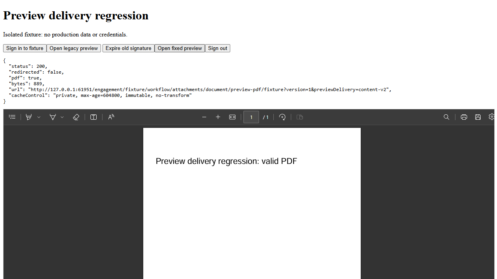

# Preview signed URL expiry fix

## Cause and scope

OSS error `0002-00000069` means the signed request expired ([official explanation](https://www.alibabacloud.com/help/en/oss/user-guide/0002-00000069)). The reported expiry and request times differ by 3 minutes 49 seconds. The source exposed a matching failure mechanism: versioned PDF preview responses permitted seven-day caching, including redirects to OSS URLs whose default lifetime is 300 seconds. The production request itself was not traced, so attribution to that particular cached redirect remains an inference.

Raw OSS PDFs and Smart Form PDF snapshots now return PDF bytes through the authorized API endpoint. Local-file delivery and converted Office PDFs keep their existing behavior. Inline redirects defensively use `private, no-store` without validators. PDF URL identity and ETag are revised to bypass previously cached redirects; ordinary versioned PDF content caching remains enabled. Project authorization is not relaxed, and signed URL lifetimes are not extended.

The first uncached OSS PDF fetch now consumes API bandwidth and buffer memory. API and EMP must both be deployed, and the client reloaded to use the new URL identity. Existing direct OSS bookmarks remain time-limited. No database migration is required.

## Local validation

Commands run from the isolated worktree, with Node 24.19.0:

| Command | Result |
| --- | --- |
| `corepack pnpm install --filter @project-wing/api... --filter @project-wing/emp... --frozen-lockfile --ignore-scripts` | Passed |
| `corepack pnpm --filter @project-wing/api exec prisma generate` | Passed; synthetic non-routable DATABASE_URL, no DB connection |
| `corepack pnpm --filter @project-wing/shared build` | Passed |
| `corepack pnpm --filter @project-wing/api test:ci src/workflow/document-conversion.service.spec.ts src/workflow/workflow.controller.spec.ts src/workflow/workflow.service.spec.ts` | 225 tests passed |
| `corepack pnpm --filter @project-wing/api test:ci src/cmp/client-search-documents/cmp-client-search-documents.service.spec.ts` | 5 tests passed |
| `corepack pnpm --filter @project-wing/emp test src/api/client.test.ts` | 22 tests passed |
| `corepack pnpm --filter @project-wing/emp test src/components/workbench-cached-preview.test.tsx src/components/file-preview-pane.test.tsx src/components/detached-attachment-preview.test.tsx` | 14 tests passed |
| `corepack pnpm --filter @project-wing/api lint` | Passed |
| `corepack pnpm --filter @project-wing/emp lint` | Passed |
| `corepack pnpm --filter @project-wing/api build` | Passed |

Tests cover raw PDF bytes, Smart Form local/OSS delivery, no-store redirect defense, old/new validators, project access revocation, and client URL revision without disabling content caching. Formatting initially failed under the shell's Node 22.14.0; rerunning the same formatter under Node 24.19.0 succeeded.

## Interactive evidence

Started `corepack pnpm --filter @project-wing/api exec tsx scripts/preview-delivery-fixture.ts` at `http://127.0.0.1:61951`. Used an isolated headless Edge session via `npx --yes --package @playwright/cli playwright-cli -s=preview-expiry`, without the user's browser profile or mouse.

The local HTTP fixture uses the real workflow controller, workflow service and document converter with synthetic storage and fixture-cookie login. Path: Sign in to fixture → Open legacy preview (200 PDF, redirected) → Expire old signature → Open legacy preview (403 XML) → Open fixed preview (200 PDF, no redirect) → repeat fixed preview (200 PDF) → Sign out → fixed preview (403, no-store). Only the two legacy requests reached the synthetic OSS endpoint. The PDF was visually inspected in Edge's PDF viewer.

This is a local backend-attached diagnostic fixture, not the complete EMP application with real authentication, database or OSS. Production/browser-login acceptance with a real project and full EMP production build were not run. No deployment, production file modification, or merge was performed as part of this fix.
