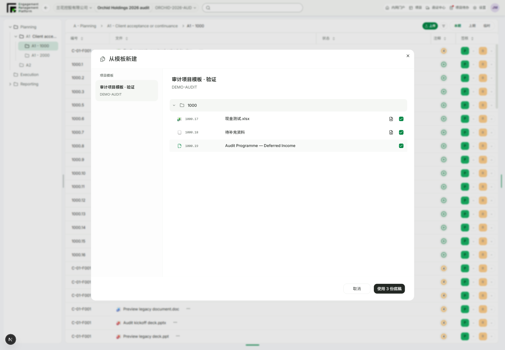
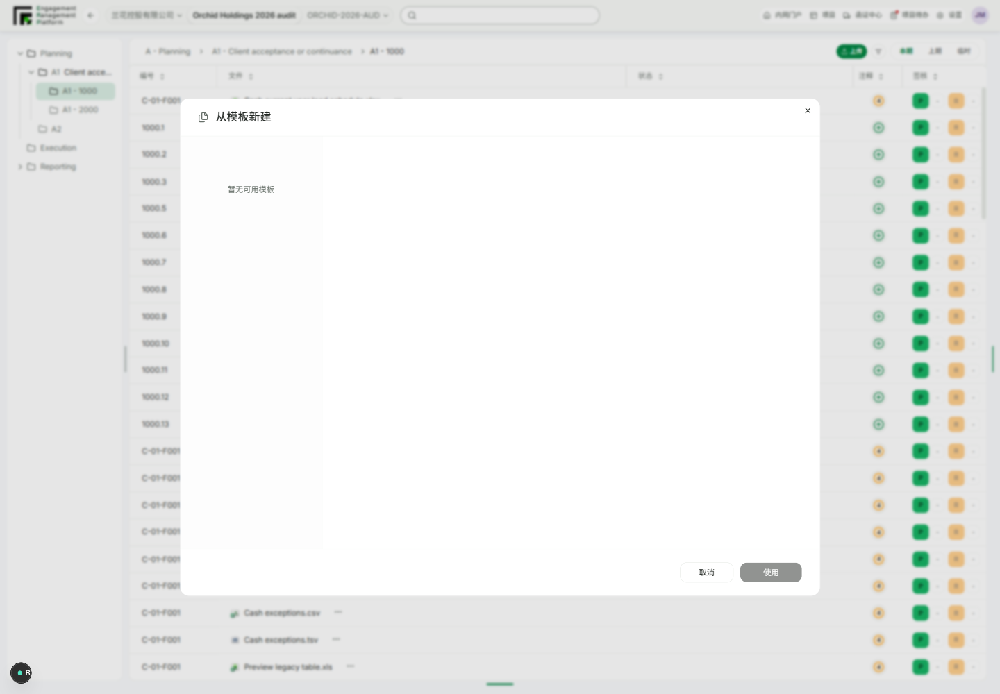

# Project template creation, repeat import and dialog polish

Worktree: `project-template-initialization`, branch `codex/fix-project-template-initialization`, integrated baseline `c47e49cd`. No shared-main edits, schema migration or real project mutation. Delivery validation is tracked below, separately from implementation evidence.

## Confirmed code defects and changes

1. New-project initialization copied every template file through object storage, including placeholders with an intentionally empty source URL. It now uses the existing file-copy helper with an explicit placeholder branch: preserve placeholder type/metadata and create no nonexistent file version. Ordinary files still copy bytes and establish their initial version/head; missing real source objects still fail initialization, rather than silently dropping content.
2. Creation still filtered published templates by the new project's display language even though UI selection/import already allowed cross-language use. Lookup now requires the selected published ID, and Smart Forms use the new project's language. A mixed file/placeholder/SmartForm regression covers this contract.
3. The routed ProjectTemplatesController import service matched existing workpapers by template source or title and skipped them. Each selected item now plans an independent copy with a fresh reference code; both files and Smart Forms can be imported again. The existing API response shape remains compatible, but the active planner produces CREATE rather than EXISTS. The mock API follows the same behavior and the dialog no longer labels selectable template content as already existing.
4. Project-template copies must not occupy the workpaper library's unique `(workflowNodeId, templateItemId, bucket)` slot. New copies keep source linkage in Attachment.templateItemId, while WorkingPaper.templateItemId is null. Existing rows and the uniqueness constraint are unchanged. Access checks and PROJECT_TEMPLATE_APPLIED audit logging are retained.
5. Repeat-import verification exposed old numeric-code normalization: 1000.4 could collide with 1000.5 in validation, and mock readback could renumber it. Numeric workpaper references now retain their digits in that comparison and mock readback; legacy -F numbering keeps its existing normalization. Explicitly reusing an occupied reference still fails.

These findings explain reproducible code paths, not every historic production failure. The earlier production reference `1b4d3749-dfd0-43c6-9cfb-6bfbb6ec74bf` has not been correlated with server logs. Missing storage objects, environment-specific failures and production acceptance remain distinct checks.

## User-directed dialog composition

Design-first was used as an existing-system consumer refinement: neutral template navigation, one flat content pane, generous padding, existing line icons and shared controls. No new design-system primitive, token, Ready claim or approval exception.

- Remove nested card borders/shadows and full green selection fills.
- No selection uses a disabled Use action, not the misleading Already applied label.
- Cancel/import controls use the same rounded treatment. Explicit zero footer margins override the local DialogFooter's negative margins; bottom padding is 24px.
- Empty template availability is stated once in the left rail. No unselected preview heading or repeated empty sentence in the right pane. Current-location description is screen-reader-only.
- Template navigation shows name/code without the item count; the action still reflects the selected import count. Title includes an aria-hidden Files icon.

## Local validation

- `corepack pnpm install --offline --frozen-lockfile --ignore-scripts`: passed.
- `corepack pnpm --filter @project-wing/api prisma:generate`: passed with a dummy localhost test URL in the command environment only; no database migration/connection. `corepack pnpm --filter @project-wing/shared build`: passed.
- `corepack pnpm --filter @project-wing/api test:ci src/projects/projects.service.spec.ts src/project-templates/project-templates.service.spec.ts`: 73 passed. The missing-object test emits its expected NoSuchKey error log. After the numeric-reference regression was added, the project-template service file reran with 20 passed (included in that suite count).
- `corepack pnpm --filter @project-wing/emp test src/api/mock-api.test.ts`: 61 passed, including repeated-copy identities, preserved contents and numeric-reference readback.
- `corepack pnpm --filter @project-wing/emp test src/components/workbench-content.test.tsx -t template`: 8 passed, 178 nonmatching skipped at the empty-state checkpoint; final presentation rerun recorded below.
- `corepack pnpm --filter @project-wing/api lint` and `corepack pnpm --filter @project-wing/emp lint`: passed at implementation checkpoints. `corepack pnpm --filter @project-wing/api build`: passed before the final numeric-comparison refinement; final API typecheck is separate evidence, not a rebuilt artifact.
- `corepack pnpm exec ultracite check apps/api/src/projects/projects.service.ts apps/api/src/projects/projects.service.spec.ts apps/api/src/project-templates/project-templates.service.ts apps/api/src/project-templates/project-templates.service.spec.ts apps/emp/src/api/mock-api.ts apps/emp/src/api/mock-api.test.ts apps/emp/src/components/workbench-template-library-dialog.tsx apps/emp/src/components/workbench-content.test.tsx`: final eight-file check passed.
- `node scripts/design-first/cli.mjs validate-registry`: structural validation passed. Scoped runAudit for `apps/emp/src/components/workbench-template-library-dialog.tsx` passed; no baseline changed. `git diff --check`: passed.

## Interactive scope and limitations

Browser URL: `http://127.0.0.1:3042/zh-CN/engagement/project-orchid-2026?templateLibrary=1`. This is the application's real, code-verified template-library entry query, not a fabricated preview route. The app consumes/removes the query when it opens the dialog.

Playwright CLI session `templatefix` runs against local **mock** EMP. `output/playwright/seed-template-verification.js` adds one explicitly synthetic mixed template to that browser's local mock store, reusing the existing published deferred-income SmartForm fixture. `verify-template-flow.js` uses the actual dialog to select all three items, confirm their references and import twice, checks distinct saved records and confirmation/readback agreement, then leaves the template visible. No production source object, cache, invitation or real project is modified.

First navigation exceeded 60 seconds while Next compiled, then the route returned 200. An initial upload-button investigation opened a browser file chooser; no file was supplied, and that isolated browser session was closed/reopened. The supported template-library query was then used. The only recurring console failure is the absent mock Desktop Agent download-manifest API at localhost:3999.

Not run: backend-attached browser login and object-storage acceptance (local Docker daemon unavailable), full API/monorepo tests, final EMP production build, production creation/import or deployment. Do not equate passing mock UI and mocked-service tests with production recovery.

## Final browser and presentation checkpoint

- Final `corepack pnpm --filter @project-wing/emp test src/components/workbench-content.test.tsx -t template`: 8 passed, 178 skipped. API and EMP final typechecks passed.
- `npx --offline --yes --package @playwright/cli playwright-cli -s=templatefix run-code --filename=output/playwright/verify-template-flow.js`: passed. Two imports created six distinct workpapers/attachments (two ordinary files, two placeholders, two SmartForms), with confirmation codes exactly matching saved records: `1000.8` through `1000.13`. No existing-item labels appeared.
- Empty hint count 1, unselected preview heading count 0. Measured button-to-dialog-bottom gap 23.99 CSS px. Inspected final screenshots `template-empty.png`, `template-selected-1.png`, `template-selected-2.png`, `template-narrow.png`, `template-confirm-1.png`, `template-confirm-2.png` under ignored `output/playwright/`. Title icon and absence of sidebar item counts are included. Width captures: 1440×1000 and 480×900; existing browser zoom means capture pixels and CSS dimensions can differ.
- The earlier mixed-import browser run exposed the numeric readback issue; it was not reported as reference-stable. The final run above asserts confirmation/readback equality after the fix. Prior synthetic copies are retained only in the isolated mock browser state, never production.

## Import latency follow-up

User reports approximately 20 seconds, but no production timing trace was available. Two concrete avoidable costs were found: `copyObjectToWorkingPaper` relayed all bytes through API GET/PUT, and the template dialog awaited workflow/audit refreshes after an already committed import.

- OSS objects up to 1 GiB now use HEAD plus same-bucket CopyObject, not API body download/upload. A source ETag precondition (when available), explicit MIME type and forbid-overwrite header protect copy semantics. Larger/unknown-size objects retain the old transfer path to avoid imposing a new size limit; no multipart lifecycle or permission changes. Local storage uses filesystem copy instead of allocating the whole file as a Buffer. Source/conditional-copy errors propagate, not hidden behind an unsafe retry. SDK behavior was checked in installed ali-oss source and [Alibaba Cloud's official copy documentation](https://www.alibabacloud.com/help/en/oss/developer-reference/copy-objects-5).
- Once the import response arrives, returned attachments populate the list immediately and the dialog closes. Workflow, attachment and audit-list refreshes run in the background. Late refresh reconciliation only appends missing IDs and cannot overwrite a subsequent user edit. Audit emission on the server is not deferred or bypassed.
- The existing API's attachment-shaped SmartForm response and legacy/mock workpaper-shaped response are both normalized; the client result type now documents both compatible shapes.

Validation for this follow-up:

- `corepack pnpm --filter @project-wing/api test:ci src/storage/storage.service.spec.ts src/projects/projects.service.spec.ts src/project-templates/project-templates.service.spec.ts`: 125 passed. New tests cover local byte identity/independent destination keys, OSS copy without GET/PUT bodies, MIME/ETag/overwrite headers, oversized fallback and unmasked copy errors.
- `corepack pnpm --filter @project-wing/emp test src/components/workbench-content.test.tsx -t template`: 8 passed, 178 skipped. `corepack pnpm --filter @project-wing/emp test src/components/workbench-content.test.tsx -t 'previews and applies a project template'`: 1 passed, 185 skipped after strengthening the regression to require `onOpenChange(false)` while refresh promises remain unresolved. The same test verifies immediate cache insertion and preservation of an edit when refresh later completes.
- `corepack pnpm --filter @project-wing/api build`, API lint and EMP lint: passed. `git diff --check`: passed.
- The real local mock browser flow/script above reran successfully, creating six independent copies with confirmation/saved references `1000.14`–`1000.19` matching exactly. Updated screenshots were captured and the final populated dialog inspected. This is workflow acceptance, not a production latency benchmark.

Production 20-second latency reduction remains unmeasured until deployment and same-template timing. No numeric speedup is claimed; no production objects or user cache were changed. Full monorepo tests and EMP production build were not run for this follow-up.

## Delivery integration

User authorized PR and merge. The settings/recycle-bin commit was integrated without conflict into this branch; no Desktop Agent change or migration is included. Representative inspected mock screenshots are now versioned for PR review:

Integration checks on the combined branch:

- `corepack pnpm --filter @project-wing/api test:ci src/storage/storage.service.spec.ts src/projects/projects.service.spec.ts src/project-templates/project-templates.service.spec.ts`: 125 passed; `corepack pnpm --filter @project-wing/api lint` passed.
- `corepack pnpm --filter @project-wing/emp test src/components/project-wing-top-bar-controls.test.tsx src/components/desktop-agent-cache-settings.test.tsx src/api/mock-api.test.ts`: 77 passed.
- `corepack pnpm --filter @project-wing/emp test src/views/projects.test.tsx -t recycle`: 2 passed, 70 skipped.
- `corepack pnpm --filter @project-wing/emp test src/components/workbench-content.test.tsx -t template`: 8 passed, 178 skipped. Combined targeted total: 212 passing tests across the four commands above, without counting prior reruns again.
- `$env:NEXT_DIST_DIR='.next-pr-validation'; corepack pnpm --filter @project-wing/emp build`: passed (exit 0), including TypeScript and 74 generated pages. Generated type references were restored to dev paths; build output is excluded from the PR.
- Ultracite check passed for all 17 changed TS/TSX files. Six integration files only needed line-ending normalization; `git diff --ignore-all-space` confirmed no semantic change from that formatting step. Registry structural validation, scoped UI boundary audit and `git diff --check` passed.

