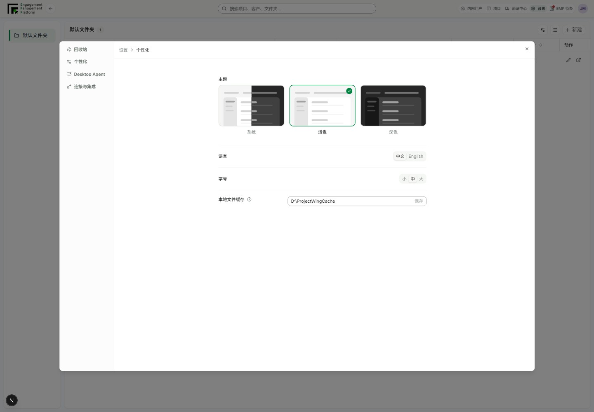
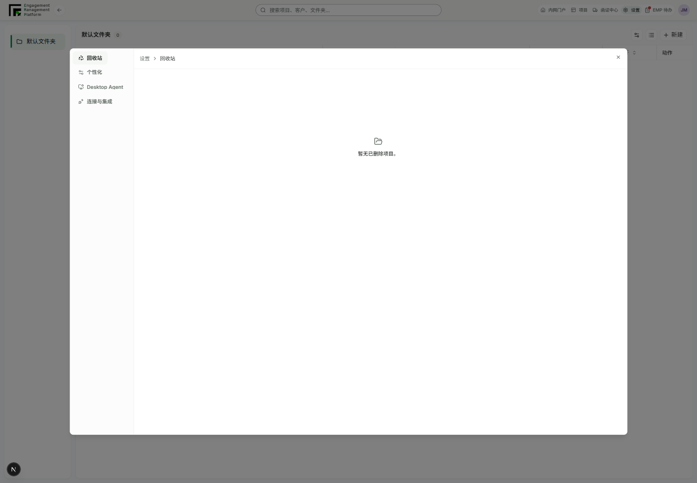

# Global settings polish — 2026-09-07

Scope: user-requested adoption of the existing project-settings visual approach for global personalization and the project recycle bin. Design-first classification: compatible consumer composition; reuse existing ThemePreferenceCards, SettingsDialogShell, CollectionState and Badge. No new design-system primitive, token, approval-state change or audit exception.

## Changes

- Personalization uses the existing theme preview cards, a centered reading width, aligned preference rows and full language labels. Theme/language/font persistence remains with its existing owner. Other LanguageSwitcher consumers retain short labels by default.
- Cache information icon follows its label; all four label left positions were identical in the actual browser. Tooltip description still appears. Existing cache save, retry, idle-required and error handling remain intact; no installed Agent settings were changed.
- Embedded recycle bin omits the repeated title/back button and heavy toolbar card. Empty/error/loading states have no selection or restore controls. Following user refinement, populated rows retain only project name/code, accessible selection and existing restore callbacks; detailed metadata and notes are omitted. The redundant recycle-bin explanatory sentence is removed from both populated and empty states. Neutral rounded cards have no shadows or green fill. Standalone navigation retains its back action and title.

## Commands and results

- `corepack pnpm install --offline --frozen-lockfile --ignore-scripts`: passed in the isolated worktree. Initial tool attempts before dependency linking completed were unavailable; rerun after installation.
- `corepack pnpm --filter @project-wing/emp test src/components/project-wing-top-bar-controls.test.tsx src/components/desktop-agent-cache-settings.test.tsx`: 16 passed.
- `corepack pnpm --filter @project-wing/emp test src/components/desktop-agent-cache-settings.test.tsx`: 3 passed after moving the icon (overlaps the prior run).
- `corepack pnpm --filter @project-wing/emp test src/views/projects.test.tsx -t recycle`: 2 passed, 70 nonmatching skipped; covers failed load/retry and selected-project restoration. Empty-state assertions require no dead controls or repeated heading/back action.
- `corepack pnpm --filter @project-wing/emp lint`: passed after both surfaces changed.
- `corepack pnpm exec ultracite check apps/emp/src/components/project-wing-top-bar-controls.tsx apps/emp/src/components/project-wing-top-bar-controls.test.tsx apps/emp/src/components/language-switcher.tsx apps/emp/src/components/desktop-agent-cache-settings.tsx apps/emp/src/views/projects.tsx apps/emp/src/views/projects.test.tsx`: passed. Existing ignored locale-save rejection now returns null instead of redundant undefined; behavior remains ignored.
- `node scripts/design-first/cli.mjs validate-registry`: passed structural validation. No whole-system Ready/Approved claim.
- `node --input-type=module -e "import {runAudit} from './scripts/design-first/cli.mjs'; const result = await runAudit({stagedFiles:['apps/emp/src/views/projects.tsx','apps/emp/src/components/project-wing-top-bar-controls.tsx','apps/emp/src/components/language-switcher.tsx','apps/emp/src/components/desktop-agent-cache-settings.tsx']}); process.exitCode = result.success ? 0 : 1;"`: passed.
- `git diff --check`: passed.

## Interactive evidence

Local **mock** EMP at `http://127.0.0.1:3041/zh-CN/engagement` → Settings → Personalization / Recycle bin. This is not production-backed acceptance. Started with `NEXT_PUBLIC_API_MODE=mock` and the ordinary `next dev -H 127.0.0.1 -p 3041`. First navigation exceeded the browser's 60-second timeout during initial compilation; the server subsequently returned 200 and the page was inspected.

Playwright CLI session `personalsettings`, scripts retained under ignored `output/playwright/`:

- `npx --offline --yes --package @playwright/cli playwright-cli -s=personalsettings run-code --filename=output/playwright/verify-personal-settings.js`: passed. Equal label x positions, visible cache help, light selection, ArrowRight keyboard selection of dark, large font selection, then original system/medium preferences restored. No cache save. An earlier probe incorrectly targeted a tooltip role; the existing tooltip renders accessible generic content, so the final check waits for its visible description instead.
- `npx --offline --yes --package @playwright/cli playwright-cli -s=personalsettings run-code --filename=output/playwright/verify-recycle-settings.js`: passed. Empty checkbox count 0; one explicitly synthetic deleted-project fixture shown, selected through Select all and restored through the actual mock UI. Only that fixture was removed afterward; no real project, file or cache mutation.
- Inspected screenshots: `personal-settings-light.png`, `personal-settings-dark.png`, `personal-settings-narrow.png`, `recycle-empty.png`, `recycle-populated.png`, `recycle-narrow.png`.
- Browser profile reports DPR 0.75: a 480px capture corresponds to 640 CSS px, and a 360px capture to 480 CSS px. Personalization dialog/content and narrow recycle content showed no horizontal overflow; recycle content width was 418.20 CSS px in the narrow capture.
- Only observed console failure: absent mock download-manifest API at localhost:3999, repeated after hot reload. No settings/recycle runtime error.

Not run at the implementation checkpoint: production-backed account/cache/project changes, production build, full monorepo tests, full visual regression or renewed whole-design-system approval. Subsequent PR integration evidence is recorded in `project-template-copy-verification-2026-09-07.md`.

## Follow-up simplification

User requested removing detailed metadata/notes and the explanatory sentence. `corepack pnpm --filter @project-wing/emp test src/views/projects.test.tsx -t recycle` reran after the final copy removal: 2 passed, 70 skipped. EMP lint passed after metadata removal; Ultracite formatting/lint and `git diff --check` passed. The compact mock fixture UI again restored only the explicitly selected synthetic project and reported `detailGroups=0`, with no narrow overflow. Final `npx --offline --yes --package @playwright/cli playwright-cli -s=personalsettings run-code --filename=output/playwright/verify-recycle-copy.js` at the same Settings → Recycle bin path returned `descriptionCount=0`, `detailGroups=0`; inspected `output/playwright/recycle-compact-final.png`. No real data mutation or deployment.

## Versioned visual evidence

