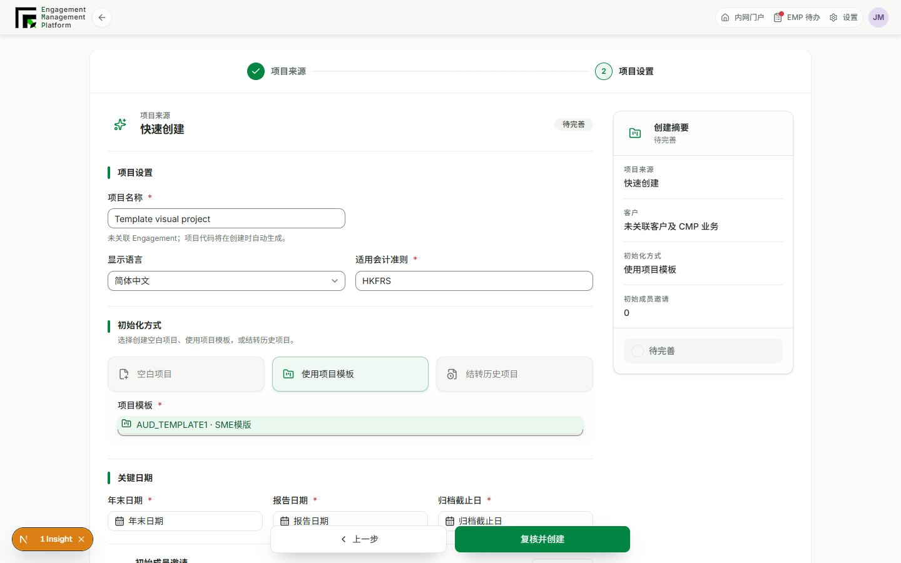
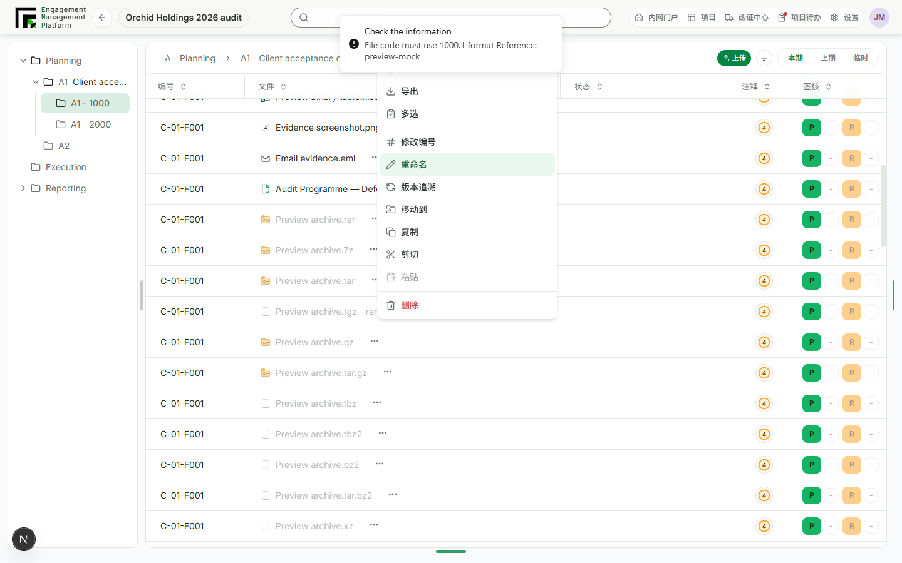

# Project creation and file action acceptance fixes

## Behavior

- Quick-create names are editable and preserved by API and mock persistence.
- Each new creation attempt starts with fresh form state and the selected desktop folder. Cancel/success returns to that folder.
- Unlinked roll-forward projects generate their code automatically and ISO source dates advance correctly by one year.
- Template/history pickers show file-type context. Blank initialization no longer repeats the same icon. The protected Archived collection does not offer active-project creation.
- Refcode and rename inputs retain printable key events instead of sending them to menu typeahead. Dependent queries refresh concurrently.
- Review/signoff notification failures are logged without converting an already completed business mutation into an error response. Audit logging remains awaited.
- Template instantiation has a longer bounded transaction timeout and a sanitized actionable error. The production template failure's precise cause has not been confirmed against live storage; this change addresses the short transaction window and error handling, not proof of every template source being valid.

## Interactive evidence

Environment: local mock EMP at `http://127.0.0.1:3033/zh-CN/engagement`.

Created a named quick project in a non-default folder; cancelled and restarted creation to confirm draft reset; created mock template and roll-forward projects; added characters and saved file refcode/name edits in the Orchid workbench. These were browser-local fixture mutations, not live backend tests.





Targeted validation commands used during implementation:

```sh
corepack pnpm --filter @project-wing/api exec vitest run src/projects/projects.service.spec.ts src/workflow/workflow.service.spec.ts
corepack pnpm --filter @project-wing/emp exec vitest run src/views/new-project.test.tsx src/api/mock-api.test.ts src/views/projects.test.tsx src/components/workbench-content.test.tsx
corepack pnpm --filter @project-wing/emp exec vitest run page.test.tsx -t "new project route"
corepack pnpm --filter @project-wing/ui exec vitest run src/error-presentation.test.ts
```

All passed at their implementation checkpoints (236 API, 330 EMP, 2 new-route and 6 error-presentation tests). Subsequent SmartForm tests and final commit-hook validation are recorded separately. Full backend-attached acceptance testing for storage copies and intermittent live latency remains outstanding.
