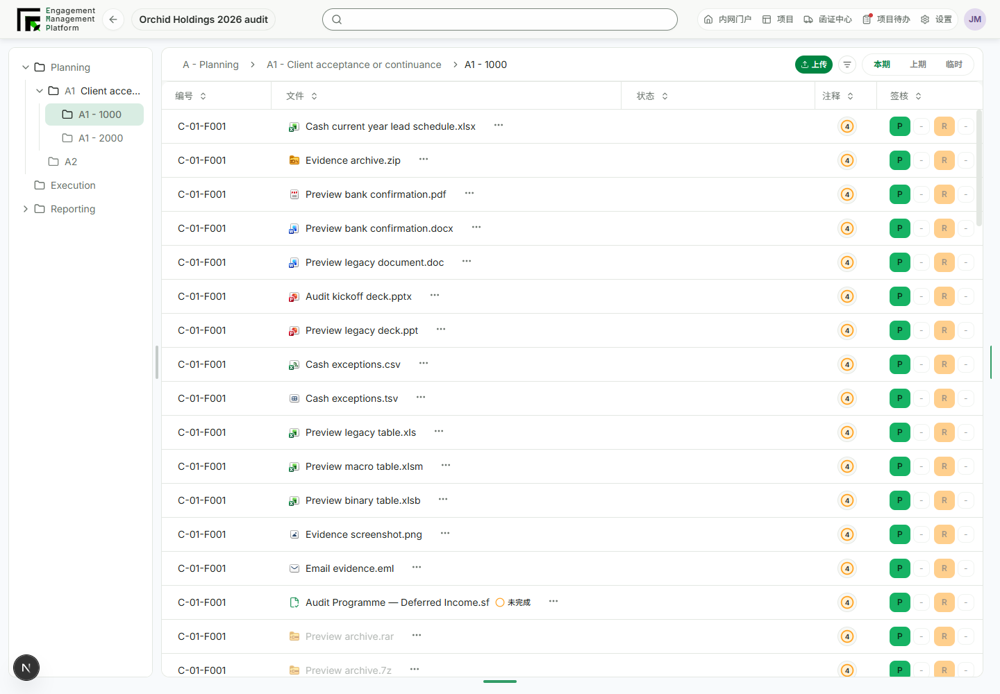
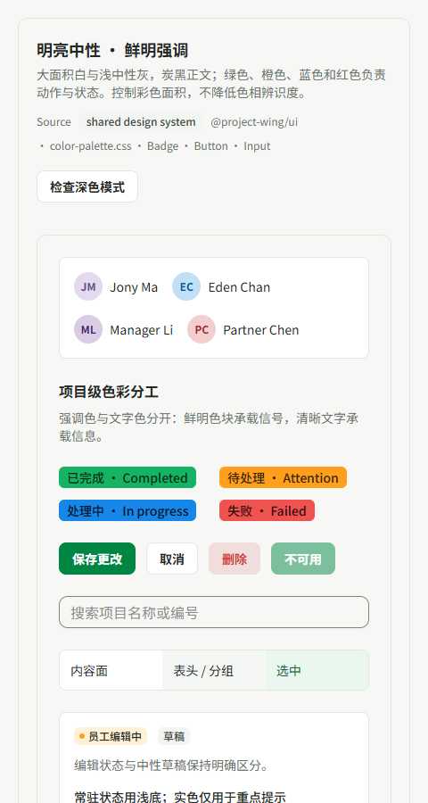

# Bright, restrained, harmonious UI

Status: implementation in local review; not merged or deployed.

Delivery checkpoint: the user requested PR and merge after reviewing the palette and avatar refinements. The branch was fast-forwarded to `95883360` (latest main at this checkpoint); upstream QA fixes did not overlap this change. The PR records the final commit-hook and delivery outcomes. Earlier validation entries below are chronological, not claims of final merge/deployment status.

Committed review evidence:

The user explicitly approved a revised project-level direction after rejecting both gray-heavy surfaces and muted brown/gray-blue emphasis. This is a material visual refinement under that direction: state meanings, permissions and responsive layouts remain intact. It is not approval of the entire experimental component registry.

- **Faithful:** keep real status text, icons and accessible contrast. Customer requirement: P preparation remains green and R review remains orange. Shared `success` / `warning` buttons now use small vivid fills and separately tested foregrounds. These role colors do not assert that a signoff has already occurred.
- **Clear:** white content surfaces, lightly differentiated headers and grouping, visible green selection and focus. Text remains dark enough to read; brightness comes from surfaces rather than fading content.
- **Refined:** retain WZ green for primary actions and selection, use tinted backgrounds for routine status, remove nested borders around repeated signoff controls.

The palette separates `*-accent` graphic fills, `*-accent-foreground` readable text on those fills, and ordinary text/status roles. Light-mode body and supporting text are neutral charcoal/gray rather than navy/slate. Status labels use neutral readable text plus a vivid dot or icon; they no longer need dark brown or gray-blue text to identify the state. CMP's shared status adapter consumes these variants across its lists. The color specimen includes the exact “员工编辑中 / 草稿” comparison, P/R, selection and a real shared data-grid composition.

Reference: the user's AI Control Tower screenshot and [ServiceNow Horizon palette guidance](https://horizon.servicenow.com/workspace/foundations/color/palettes). ProjectWing's values are an original adaptation, not claimed as sampled ServiceNow tokens. Neutral surfaces occupy the large areas; chromatic signals stay deliberate and distinct.

| Role | Light value | Use |
| --- | --- | --- |
| Canvas / content | `#F7F8F6` / `#FFFFFF` | Light neutral structure |
| Body / supporting text | `#232824` / `#68716A` | Neutral, readable typography |
| Primary | `#008542` | Main action and focus |
| Green accent | `#16B364` | Positive indicators and P |
| Orange accent | `#FF9F1C` | Attention indicators and R |
| Blue accent | `#1687E8` | Information indicators |
| Red accent | `#EF5350` | Error/critical indicators |

Ownership is project-wide: `packages/ui` owns the palette, HTML/canvas grid surfaces, outlined buttons and tinted action variants. EMP consumes the shared green/orange actions in both file rows and the signoff panel. EMP, CMP, TMS, Intranet and the showroom already alias the canonical palette; there are no route-specific palette overrides in this change. Existing app-local button adapters retain their APIs and follow the same white outline surface.

## Validation and review evidence

- `pnpm --filter @project-wing/ui exec vitest run --maxWorkers=1`: 25 files / 176 tests passed, including light/dark ordinary-text contrast at 4.5:1, input/focus contrast at 3:1, vivid-fill foregrounds and neutral typography checks.
- `pnpm --filter @project-wing/emp exec vitest run src/components/workbench-content.test.tsx -t signoff --maxWorkers=1`: 18 passed / 165 intentionally filtered out. Preparation/review permissions and actions retained.
- `pnpm --filter @project-wing/cmp exec vitest run src/components/cmp-data-grid-status-badge.test.tsx --maxWorkers=1`: 5 passed.
- `pnpm --filter @project-wing/ui --filter @project-wing/emp --filter @project-wing/cmp --filter @project-wing/tms --filter @project-wing/intranet --filter @project-wing/ui-showroom --workspace-concurrency=1 -r lint`: first five workspaces passed; showroom initially caught two missing specimen-table props. After fixing those, `pnpm --filter @project-wing/ui-showroom lint` passed.
- `pnpm --filter @project-wing/emp --filter @project-wing/ui-showroom --workspace-concurrency=1 -r build`: both production builds passed, exit 0. Existing showroom dynamic font-path tracing and Node shell deprecation warnings remain; no claim of warning-free output.
- `pnpm exec ultracite check --no-error-on-unmatched-pattern <changed paths>` and `git diff --check`: passed.
- `node scripts/design-first/cli.mjs validate-registry`: passed. Boundary audit reports 103 historical failures / 413 findings, identical to the preceding branch baseline. No exemption growth or global system-approval claim.

Playwright browser checks:

- `http://127.0.0.1:3038/specimens/Color`: actual shared components, 1440px light and dark compatibility; the first 480px check caught intrinsic grid overflow, fixed with a zero-minimum grid track. Recheck: viewport and document width both 480px.
- `http://127.0.0.1:3031/zh-CN/engagement/project-orchid-2026`: real EMP components using the repository's mock API, inspected at 1920px and 480px. P stays green, R orange, disabled review remains unavailable. No real business mutations.
- Screenshots under `output/playwright/`: `vivid-color-desktop.png`, `vivid-color-dark.png`, `vivid-color-narrow.png`, `vivid-status-table-narrow.png`, `vivid-workbench-wide.png`, `vivid-workbench-narrow.png`.

Limits: no final backend-attached authenticated-flow acceptance, no full root test suite, and no exhaustive per-route visual claim. The mock workbench logs an unavailable local Desktop Agent manifest request; the color specimen has no application console error. The offline install linked dependencies but ended with an unapproved unrelated electron-winstaller script; no execution permission was granted. No commit, push, PR or deployment for this revision.

## Follow-up: remaining brown note indicators

The customer reaffirmed the rule: accents must retain vivid chroma, with low-chroma colors reserved for backgrounds. The shared EMP note indicator was still using the legacy text-warning/text-success roles for both ring and number. It now uses bright warning/success accents for the ring, subtle backgrounds, and a neutral readable numeral. Inline SmartForm completion follows the same icon/text separation. P green / R orange is unchanged.

- `pnpm --filter @project-wing/emp exec vitest run src/components/workbench-content.test.tsx --maxWorkers=1`: all 183 tests passed after this follow-up.
- `pnpm exec ultracite check apps/emp/src/components/workbench-paper-section.tsx apps/emp/src/components/workbench-content.test.tsx` and `git diff --check`: passed.
- Playwright checked the mock workbench at `http://127.0.0.1:3031/zh-CN/engagement/project-orchid-2026`, 1440×1000. Screenshot: `output/playwright/note-accent-correction.png`. No real business mutation; the unrelated mock Desktop Agent manifest request remains unavailable.
- The production build was not rerun for this display-only follow-up. No PR or deployment.

## Project-wide adoption and avatar balance

The user approved extending the ServiceNow-inspired color-role separation across the project. This pass migrated EMP's general StatusBadge, shared outlined status badges, TMS approval/query/overview status labels, hours validation cells and warning notices. High-chroma marks and borders carry emphasis; body text stays neutral on low-chroma surfaces. State calculations, labels, permissions and workflow transitions were not changed. The existing shared palette continues to flow into CMP and Intranet without copying an application-specific palette.

Avatars retain the existing 20-tone Microsoft name-hash mapping. The original gray-mixed initials were replaced with chromatic initials and no shadow. Following the user's feedback that 10% backgrounds looked too pale, light-mode backgrounds use 24% identity tone and initials use 75% identity tone plus black. Dark mode is independently styled. All 20 light and 20 dark pairs meet 4.5:1; the final light-mode minimum is approximately 4.73:1.

- `pnpm --filter @project-wing/ui exec vitest run --maxWorkers=1`: 218 passed before the final avatar-strength adjustment; `pnpm --filter @project-wing/ui exec vitest run src/project-wing-top-bar-avatar.test.tsx --maxWorkers=1`: all 42 avatar checks passed after it.
- `pnpm --filter @project-wing/tms exec vitest run --maxWorkers=1`: 235 passed after updating an old Absent-pill color assertion and adding hours-state color contracts.
- `pnpm --filter @project-wing/emp exec vitest run src/components/status-badge.test.tsx --maxWorkers=1`: 4 passed; the complete `src/components/workbench-content.test.tsx` run passed all 183 tests.
- Six-workspace `-r lint` type checks passed; shared UI was checked again after adding avatar tests. Formatting/lint and registry checks passed.
- Browser QA uses mock-only local APIs: EMP at port 3031 and TMS at port 3034. TMS login used a dummy local fixture identity, opened Approvals, selected July 2026 to show seeded records, and checked desktop/480px layouts (document width 480px). No submission or approval was executed. Avatar and status samples were checked in the showroom at port 3038.
- New screenshots: `avatar-balanced-colors.png`, `avatar-bright-workbench.png`, `avatar-colors-dark.png`, `tms-approval-populated-colors.png`, `tms-approval-colors-narrow.png`. The bright-workbench screenshot predates the final 24% avatar background; use avatar-balanced-colors for the final avatar treatment.
- `pnpm --filter @project-wing/emp --filter @project-wing/tms --filter @project-wing/ui-showroom --workspace-concurrency=1 -r build`: all three builds completed successfully during this pass. The final avatar background-strength adjustment was subsequently checked through all 42 avatar tests and the rendered showroom; it was not separately rebuilt for each application. No release artifact or deployment is claimed for this local preview.

# Dialog dividers and general-settings alignment follow-up

User feedback identified inherited text-color borders in dialogs/drawers and an off-center general-settings form. The shared stylesheet now gives unspecified borders the theme divider color in the CSS base layer; explicit input, focus and semantic border utilities retain precedence. General settings uses a content-sized label column and a flexible control column, switching to stacked fields based on the form container, not the browser viewport. No settings persistence or permission behavior changed.

Verification on 2026-09-05:

- `corepack pnpm --filter @project-wing/ui test src/border-defaults.test.ts`: 1 passed.
- `corepack pnpm --filter @project-wing/emp test src/views/workbench-settings-panel.test.tsx`: 25 passed.
- `corepack pnpm --filter @project-wing/emp lint` and `corepack pnpm --filter @project-wing/ui lint`: both TypeScript checks passed.
- Playwright CLI `run-code --filename .codex/settings-check.js` on EMP mock port 3031, project Orchid → Settings → General: all six label edges, control widths and right bounds checked at 1280/800/480px. Desktop columns measured 56px/496px; narrower panels use a single 430px column. Light and dark screenshots inspected. No business records submitted. Known unavailable Desktop Agent manifest request remains.
- First color commit's complete normal pre-commit gate passed: CMP 299, EMP 1594, TMS 235, Intranet 47 and shared UI 219 tests. Follow-up commit gate results are reported in the PR after completion.

Screenshots: `docs/review-assets/bright-harmony/settings-desktop.png`, `settings-narrow.png`, `settings-dark.png`.

The real EMP mock path Project Orchid → Confirmations → HSBC Hong Kong → Upload response opened the “收到回函” dialog. Its footer and the follow-up sheet's left border both measured `rgb(227, 231, 226)` / 1px, distinct from text `rgb(35, 40, 36)`; the focused textarea retained its explicit `rgb(125, 137, 127)` input border. Screenshots inspected; dialogs dismissed without submitting. The bank-library endpoint failed in this mock environment, so its specific detail drawer remains unverified interactively.

`NEXT_DIST_DIR=.next-divider-build NEXT_PUBLIC_API_MODE=mock corepack pnpm --filter @project-wing/emp build` passed (separate build directory preserves the preview server). A concurrent full CMP run hit an invalid-field focus timing failure; this is recorded and will be rerun with build work finished, without weakening assertions.
