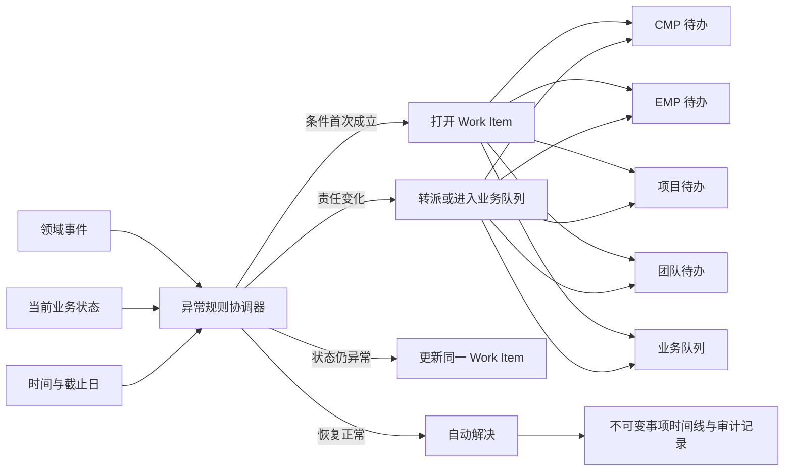
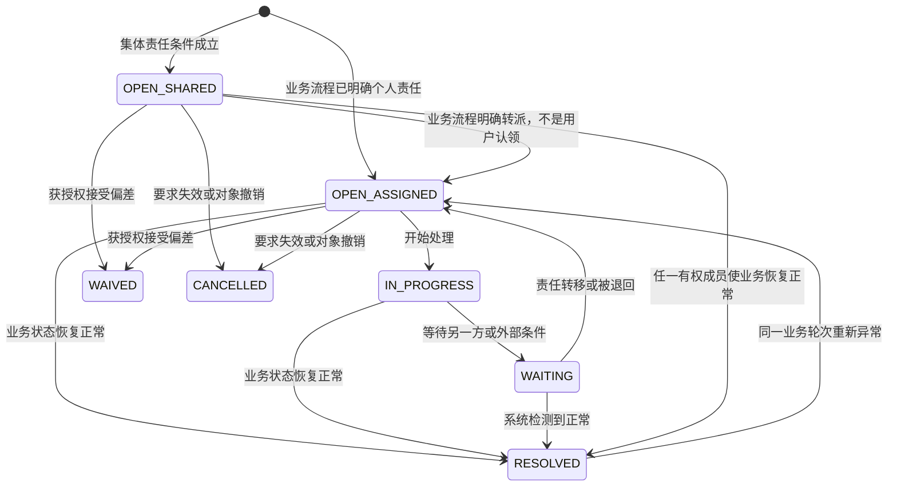

# Project Wing 统一待办与异常处理目录

日期：2026-08-31

状态：完整发现目录；是否进入实施由 `work-item-filtered-implementation-proposal.md` 决定

## 1. 目的

Project Wing 不再以“收到多少条消息”为核心，而以“还有哪些业务状态没有恢复正常”为核心。

本文件盘点当前 EMP、项目执行、CMP、TMS 与平台运维中可以转化为统一待办的持续状态，并明确：

- 异常何时打开；
- 当前责任属于用户、角色、项目、业务队列还是系统；
- 它出现在哪个工作域；
- 什么业务动作会使它自动解决；
- 什么情况下只是通知或同步校验，不应创建待办；
- 当前代码已经存在的事实来源。

这里的“异常”是内部架构术语，表示实际状态偏离目标状态，不表示程序错误。用户界面统一使用“我的待办”“项目待办”“团队待办”“需关注事项”等措辞。

## 2. 总体模型



统一事项不是消息副本。每个规则、业务对象和业务轮次最多存在一个活动事项：

```text
dedupeKey = ruleId + subjectType + subjectId + cycleKey
```

归档前 10 天、5 天和 1 天的提醒只更新同一个“完成项目归档”事项的紧迫度；不会创建三个并列待办。

## 3. 责任与视图

| 责任类型 | 含义 | 是否进入“我的待办” |
| --- | --- | --- |
| `USER` | 已明确到具体用户 | 是，仅进入该用户的待办 |
| `PROJECT_ROLE` | 由项目 PIC、MIC、编制人、复核人等角色负责 | 唯一负责人进入“我的待办”；多人集合进入“团队待办”，任一有权成员可直接前往处理 |
| `PROJECT` | 项目团队中需要有一人处理 | 否，进入“团队待办”，不增加每个成员的个人待办数量，也没有认领流程 |
| `DOMAIN_QUEUE` | 财务、IT、系统管理员等职能队列 | 进入对应团队/职能队列，任一有权成员可直接处理 |
| `SYSTEM` | 系统应先自动重试或自动修复 | 仅在重试耗尽、需要人工介入时升级 |

工作域与对象粒度如下：

| 工作域 | 对象粒度 | 主要入口 |
| --- | --- | --- |
| `CMP` | 客户、承接、Engagement、账单与主数据 | CMP 待办 |
| `EMP` | 项目整体、项目成员、独立性与项目生命周期 | EMP 待办 |
| `PROJECT` | 底稿、附件、复核问题、SmartForm | 项目待办、团队待办 |
| `TMS` | 个人期间、工时行、Engagement 审批与项目映射 | TMS 待办 |
| `OPS` | 集成、后台任务、连接与恢复操作 | OPS 待办，仅 `SUPER_ADMIN` 可见 |

## 4. 生命周期



`seenAt` 可以保留用于“新事项”提示，但不是生命周期状态。用户不能通过“标记已读”解决事项。

## 5. 现状依据标记

| 标记   | 含义                                                     |
| ------ | -------------------------------------------------------- |
| `消息` | 当前由 `InboxMessage` 或邮件产生，但没有完整待办生命周期 |
| `状态` | 已有持久化业务状态，可以直接投影为事项                   |
| `检查` | 已有检查器可重复计算条件，例如 File Check                |
| `规格` | 已有批准或在评审中的设计规格，但生产模型未完全覆盖       |
| `规划` | 本目录提出的规则，尚未接入                               |

## 6. EMP 与项目生命周期异常目录

| ID | 异常条件 | 默认责任 | 工作域/视图 | 自动解决或转派条件 | 依据 |
| --- | --- | --- | --- | --- | --- |
| `EMP-001` | 用户尚未签署系统级独立性声明 | `USER`：当前用户 | EMP / EMP 待办 | 当前版本声明签署成功 | 状态：`IndependenceDeclaration(projectId=null)` 与声明路由守卫 |
| `EMP-002` | 项目邀请仍为 `PENDING` 且未过期 | `USER`：受邀用户 | EMP / EMP 待办 | 接受邀请、撤销邀请或到期 | 消息+状态：`ProjectInvitation` |
| `EMP-003` | 活跃项目成员尚未签署加入后的项目独立性声明 | `USER`：该项目成员 | EMP / EMP 待办；项目成员管理也可见 | 签署声明、成员被移除或项目关闭 | 状态：`IndependenceDeclaration(projectId)`，且签署时间必须晚于 `joinedAt` |
| `EMP-004` | 项目职责与用户全局职级不一致 | `PROJECT_ROLE`：PIC/MIC 或有成员管理权限者 | EMP / EMP 待办 | 将成员职责调整到允许集合或移除成员 | 状态：`roleConsistent=false`，现有成员服务可计算 |
| `EMP-005` | 活跃项目缺失最低责任结构，例如没有有效 Partner/PIC/MIC | `PROJECT`，升级到项目所有者/管理员 | EMP / EMP 待办 | 补齐有效责任人或项目关闭 | 规划；现有成员删除规则已经防止删除最后一位 Partner，但尚无统一检查 |
| `EMP-006` | CMP Engagement 已最终批准，但应建立的 EMP 项目尚未创建或绑定 | `PROJECT_ROLE`：承接申请指定的 MIC/PIC；无法唯一确定时进入 EMP 项目建立队列 | EMP / EMP 待办 | 创建并绑定 EMP 项目，或经授权标记“不创建” | 消息：`CMP_ENGAGEMENT_APPROVED`；现有消息只是“可创建项目” |
| `EMP-007` | 项目归档截止日临近且项目仍为 `ACTIVE` | `PROJECT_ROLE`：PIC/MIC；其他成员可关注但不复制待办 | EMP / EMP 待办 | 项目进入 `PENDING_FINAL_CHECK`、归档、截止日调整或项目关闭 | 消息+状态：当前 10/5/1 天分别发消息；新模型合并为单一事项 |
| `EMP-008` | 已超过归档截止日且项目仍未提交最终检查 | 与 `EMP-007` 相同，严重程度升级为逾期 | EMP / EMP 待办（高优先级） | 与 `EMP-007` 相同 | 规划；当前只有截止日前提醒，没有稳定的逾期事项 |
| `EMP-009` | 项目为 `PENDING_FINAL_CHECK`，等待最终归档审核 | `DOMAIN_QUEUE`：当前为所有 `SUPER_ADMIN`；未来应为明确归档审核队列 | EMP / 归档审核待办 | 确认归档后进入归档任务，或退回项目 | 消息+状态：`PROJECT_ARCHIVE_REVIEW_REQUESTED` |
| `EMP-010` | 项目从最终归档审核被退回，恢复为 `ACTIVE` | `PROJECT_ROLE`：原提交人优先，否则 PIC/MIC | EMP / EMP 待办 | 修正问题并重新提交归档，或项目状态改变 | 消息：`PROJECT_ARCHIVE_REVIEW_RETURNED`；当前发送给所有项目成员 |
| `EMP-011` | 最终归档后台任务失败 | `USER`：确认归档的管理员；无法处理时升级 `OPS` | EMP / EMP 待办；OPS 镜像仅 `SUPER_ADMIN` 可见 | 重试成功、项目被退回或任务取消 | 状态：`ProjectArchiveJob.status` 与 `errorMessage` |
| `EMP-012` | 项目文件导出任务失败 | `USER`：导出发起人 | EMP / EMP 待办 | 重试成功、重新创建导出或用户放弃并取消 | 状态：`ProjectFileExportJobStatus.FAILED` |

## 7. 项目执行与 File Check 异常目录

以下项目直接沿用 File Check 的持续条件。File Check 仍可作为归档前总检查，但统一待办应在日常工作中持续投影这些条件，而不是等到归档时才首次出现。

其中 `PRJ-011` 至 `PRJ-014` 为 Warning，只保留在 File Check 报告和定位导航中，不生成待办。`PRJ-015` 虽然当前检查结果同样标记为 Warning，但它表示检查基础设施无法完成工作；系统重试耗尽后仍需要人工恢复，因此保留为待办候选。

| ID | 异常条件 | 默认责任 | 工作域/视图 | 自动解决或转派条件 | 依据 |
| --- | --- | --- | --- | --- | --- |
| `PRJ-001` | 当前附件没有编制签核 | `USER`：底稿编制人；未指定时为 `PROJECT` | PROJECT / 项目待办 | 有效编制签核建立 | 检查：`MISSING_PREPARER_SIGNOFF`，Blocker |
| `PRJ-002` | 当前附件没有复核签核 | `USER`：底稿复核人；未指定时为 `PROJECT` | PROJECT / 项目待办 | 有效复核签核建立 | 检查：`MISSING_REVIEWER_SIGNOFF`，Blocker；`WORKING_PAPER_PREPARED` 消息可改为该事项的责任转移事件 |
| `PRJ-003` | 复核签核时间不晚于编制签核 | `USER`：复核人；无法唯一确定时为项目 PIC | PROJECT | 重新完成有效顺序的签核 | 检查：`REVIEW_SIGNOFF_BEFORE_PREPARER`，Blocker |
| `PRJ-004` | 同一用户同时完成编制和复核签核 | `PROJECT_ROLE`：PIC/MIC | PROJECT / 项目待办 | 更换独立复核人并重新签核，或有权限者执行受控豁免 | 检查：`SELF_REVIEWED_WORKING_PAPER`，Blocker |
| `PRJ-005` | 复核问题尚未 `CLEARED` | 一个 Q 一个事项、多个投影：团队待办始终显示；提出者的项目待办始终显示；被分配人的项目待办仅在 `OPEN` 时显示 | PROJECT / 项目待办和团队待办 | `WorkingPaperQuestion.status=CLEARED` | Assignment 不影响团队可见性；现有已指定 Q 的回复权限保持不变 |
| `PRJ-006` | 复核问题为 `REPLIED` | 不单独生成待办 | `PRJ-005` 的生命周期状态 | Clear 后解决；Follow-up 后同一事项重新由回复侧处理 | 消息：`REVIEW_QUESTION_REPLIED`，合并进 `PRJ-005` |
| `PRJ-007` | 复核问题未指定回复人 | 不是异常，不单独生成待办 | `PRJ-005` 的责任呈现状态 | 未 Clear 时同一 `PRJ-005` 事项显示在团队待办；未来指定回复人只会增加其个人 `OPEN` 待办，不会移除团队投影 | 无指定回复人是合法可选状态；异常条件始终是“Q 未 Clear” |
| `PRJ-008` | 当前附件仍被 Desktop Master 会话锁定 | `USER`：锁持有人；超时后升级项目 PIC/OPS | PROJECT / 项目待办 | 正常 Check-in、Release、受控撤销锁或会话恢复 | 检查：`LOCKED_ATTACHMENT`，Blocker |
| `PRJ-009` | 附件存在未裁决的版本冲突并被冻结 | `PROJECT_ROLE`：项目所有者/PIC | PROJECT / 项目待办 | 选择服务端版本、冲突版本或共同父版本并完成冲突解决 | 消息+状态：`ATTACHMENT_CONFLICT` 与 `conflictFrozenAt` |
| `PRJ-010` | SmartForm 实例为 `INCOMPLETE` | `USER`：最近保存人或底稿编制人；无法唯一确定时为 `PROJECT` | PROJECT / 项目待办 | 必填规则全部通过，实例状态变为 `COMPLETE` | 检查+状态：`SMART_FORM_INCOMPLETE`，Blocker |
| `PRJ-011` | Word 当前文件仍有修订痕迹 | 不生成待办 | File Check Warning | 接受或拒绝全部修订后重新检查通过 | 检查：`DOCX_TRACK_CHANGES`，Warning |
| `PRJ-012` | Word 当前文件仍有未解决批注 | 不生成待办 | File Check Warning | 批注解决或删除后重新检查通过 | 检查：`DOCX_UNRESOLVED_COMMENT`，Warning |
| `PRJ-013` | Excel 当前文件仍有未解决批注 | 不生成待办 | File Check Warning | 批注解决或删除后重新检查通过 | 检查：`XLSX_UNRESOLVED_COMMENT`，Warning |
| `PRJ-014` | Excel 当前文件包含错误值 | 不生成待办 | File Check Warning | 修复错误值，或由有权限者记录接受理由 | 检查：`XLSX_ERROR_VALUE`，Warning，不阻塞归档 |
| `PRJ-015` | Office 文件检查无法完成 | 首先 `SYSTEM` 自动重试；耗尽后分派最近修改人或 OPS | PROJECT / OPS 待办 | 检查重试成功、文件替换或受控豁免 | 检查：`OFFICE_FILE_CHECK_FAILED`，Warning |
| `PRJ-016` | Zip/Master 会话处于 `CHECKIN_FAILED`、`RELEASE_FAILED`、`RECOVERABLE` 或 `BASE_VERSION_CONFLICT` | `USER`：会话所有者；必要时升级 OPS | PROJECT / 项目待办 | 恢复、重试、解决基线冲突或受控关闭会话 | 状态：`ZipMasterSessionState` |

## 8. CMP 异常目录

| ID | 异常条件 | 默认责任 | 工作域/视图 | 自动解决或转派条件 | 依据 |
| --- | --- | --- | --- | --- | --- |
| `CMP-001` | 承接草稿已明确分派，但受派人尚未完成 | `USER`：`draftAssigneeId` | CMP / CMP 待办 | 完成草稿后转给发起人或 MIC；撤回/取消则结束 | 消息+状态：`CMP_ACCEPTANCE_DRAFT_ASSIGNED`、`STAFF_EDITING` |
| `CMP-002` | 受派草稿已经完成，等待发起人复核或正式提交 | `USER`：`submittedById` | CMP / CMP 待办 | 正式提交、重新分派或取消 | 消息：`CMP_ACCEPTANCE_DRAFT_COMPLETED` |
| `CMP-003` | 承接申请等待 MIC 审批 | `USER`：`micApproverId` | CMP / CMP 待办 | MIC 通过后转 PIC/IT；退回后转 `CMP-006` | 状态：`PENDING_MIC` 与审批步骤 |
| `CMP-004` | 承接申请等待 PIC 审批 | `USER`：`picApproverId` | CMP / CMP 待办 | PIC 通过后转 IT 或结束；退回后转 `CMP-006` | 状态：`PENDING_PIC` 与审批步骤 |
| `CMP-005` | 承接申请等待 IT 审批和主数据写入 | `USER`：`itApproverId` | CMP / CMP 待办 | 最终批准并写入主数据；退回后转 `CMP-006` | 状态：`PENDING_IT` 与审批步骤 |
| `CMP-006` | 承接申请被退回 | `USER`：现有 `resolveAcceptanceReturnRecipientId` 解析的处理人 | CMP / CMP 待办 | 修正并重新提交、重新分派或取消 | 消息+状态：`CMP_ACCEPTANCE_RETURNED` |
| `CMP-007` | Engagement 归档草稿尚待 MIC/项目负责人完成 | `USER`：归档草稿提交人/MIC | CMP / CMP 待办 | 提交 PIC 审批或取消草稿 | 状态：`CmpEngagementArchiveWorkflowStatus.DRAFT` |
| `CMP-008` | Engagement 归档等待 PIC 审批 | `USER`：该 Engagement PIC | CMP / CMP 待办 | PIC 批准归档或退回 | 状态：`PENDING_PIC` |
| `CMP-009` | Engagement 归档被退回修改 | `USER`：原提交人/MIC | CMP / CMP 待办 | 修正并重新提交或取消 | 状态：`RETURNED` |
| `CMP-010` | 账单草稿已提交，等待 PIC 审批 | `USER`：Engagement PIC | CMP / CMP 待办 | 批准后转 `CMP-012`；退回后转 `CMP-011` | 状态：`CmpBillingStatus.SUBMITTED` |
| `CMP-011` | 账单从审批退回到草稿 | `USER`：账单创建人，必要时 MIC 协作 | CMP / CMP 待办 | 修正后重新提交或删除草稿 | 状态事件 action=`RETURNED`，账单状态回到 `DRAFT` |
| `CMP-012` | 已批准账单尚未发送客户 | `PROJECT_ROLE`：Engagement MIC/PIC 或明确账单处理人 | CMP / CMP Engagement 待办 | 标记发送并保存证据 | 状态：`APPROVED` |
| `CMP-013` | 已发送账单尚未收到客户付款申报 | `PROJECT`：Engagement；若配置催收人则分派用户 | CMP / Engagement 待办 | 客户付款被申报、账单作废或进入正式催收流程 | 状态：`SENT`；当前没有明确付款截止日，需先确定策略 |
| `CMP-014` | 客户已申报付款，等待财务到账凭证与核销 | `DOMAIN_QUEUE`：财务；任一有权财务成员可直接处理 | CMP / 财务待办 | 收款凭证齐全、金额平衡并成功 `RECONCILED` | 状态：`CLIENT_PAID` 与 finance receipts |
| `CMP-015` | 到账凭证缺失、金额不平或币种换算资料不足，无法核销 | `DOMAIN_QUEUE`：财务 | CMP / 财务异常待办 | 补齐证据、修正收款记录或经授权覆盖并说明理由 | 状态+同步校验：`CMP_BILLING_RECEIPT_REQUIRED`、`CMP_BILLING_NOT_BALANCED` |
| `CMP-016` | 公司身份匹配或关联方关系存在冲突 | 当前先同步阻塞；若冲突草稿可持久化，则为 CMP 数据治理队列 | CMP / 数据治理待办 | 选择现有实体、修正身份字段、修正持股/投票比例或放弃变更 | 状态/校验：Company Identity Conflict 与 entity graph relationship conflict |
| `CMP-017` | 汇率刷新失败且业务只能依赖过期数据或缺失 fallback | 首先 `SYSTEM` 重试；耗尽后财务/OPS | CMP / 财务或OPS 待办 | 成功刷新、录入受控 fallback 或取消依赖操作 | 状态：exchange-rate batch/fallback；需补充明确失败持久化策略 |

## 9. TMS 异常目录

TMS 已有部分状态和一类退回消息。满足明确责任路径且不是重复/子 finding 的规则进入筛选后实施提案。

| ID | 异常条件 | 默认责任 | 工作域/视图 | 自动解决或转派条件 | 依据 |
| --- | --- | --- | --- | --- | --- |
| `TMS-001` | 当前半月期间已进入应填报窗口，但工时仍未提交 | `USER`：工时所有者 | TMS / TMS 待办 | 提交对应半月；人员状态变为离职/长期休假时取消或调整 | 规划；现有状态可计算 `DRAFT/NOT_SUBMITTED`，截止策略尚未定义 |
| `TMS-002` | 工作日总工时为零或提交数据存在未填工作日 | `USER`：工时所有者 | TMS / 作为 `TMS-001` 的动态详情，不单独生成待办 | 补齐工作日工时或登记 Leave/Absent；提交后父待办消失 | 状态：审批筛选器已有 `recordHasMissingWorkday` |
| `TMS-003` | Normal 工时单日超过 8 小时或提交数据不符合行类型规则 | `USER`：工时所有者 | TMS / 作为 `TMS-001` 的子 finding，不单独复制主待办 | 修正数据并通过提交校验 | 同步校验：`TmsTimesheetRowSchema` |
| `TMS-004` | 工时审批被退回 | `USER`：工时所有者 | TMS / TMS 待办 | 修改并重新提交 | 消息+状态：`TMS_TIMESHEET_RETURNED`、`RETURNED` |
| `TMS-005` | 工时已提交，等待 Engagement 审批 | `USER`：由 Engagement 审批权限解析出的 PIC/MIC/审批人 | TMS / TMS 待办 | 批准后解决；退回后转 `TMS-004` | 状态：`SUBMITTED` |
| `TMS-006` | 审批人修改了已提交/已批准工时，等待最终确认 | `USER`：当前审批人或规则指定的确认人 | TMS / TMS 待办 | 确认批准、退回员工或撤销修改 | 状态：`PENDING_CONFIRMATION` |
| `TMS-007` | 工时引用的项目行尚未映射到 EMP 项目 | `USER`：行所有者可提出；实际治理责任为 TMS/EMP 映射管理员 | TMS / 项目映射队列 | `TmsProjectLink.status=LINKED` | 状态：`TmsProjectLink.PENDING` |
| `TMS-008` | 已提交工时因为 EMP 项目尚未绑定 CMP Engagement 而等待联结 | `PROJECT`：对应 EMP 项目，升级项目 PIC/MIC | EMP 待办，同时在 TMS 显示上下文 | 项目绑定 Engagement 后系统自动 reconcile | 状态：`TmsPendingLinkSubmission.PENDING_LINK` |
| `TMS-009` | Engagement 无可用 EMP 项目，导致相关成员无法进入正常工时链路 | `PROJECT_ROLE`：Engagement MIC/PIC | EMP 或 CMP 待办，取决于缺失阶段 | 创建并绑定 EMP 项目 | 状态原因：`EMP_PROJECT_REQUIRED` |
| `TMS-010` | EMP 项目成员尚未完成项目独立性声明，导致工时访问/联结受限 | `USER`：对应成员 | EMP / EMP 待办；TMS 仅展示阻塞原因 | 完成项目声明 | 状态原因：`INDEPENDENCE_DECLARATION_REQUIRED`，与 `EMP-003` 去重 |

## 10. 平台与集成异常目录

这些事项不应污染普通用户的项目待办。系统应先自动恢复，只有需要人类判断、凭证或权限时才升级。

| ID | 异常条件 | 默认责任 | 工作域/视图 | 自动解决条件 | 依据 |
| --- | --- | --- | --- | --- | --- |
| `OPS-001` | 用户邮件连接为 `ERROR` | `USER`：连接所有者；全局故障升级 OPS | OPS / 设置页提示或OPS 待办 | 连接验证成功 | 状态：`UserMailConnection.status/lastError` |
| `OPS-002` | 17TRACK 等系统连接为 `ERROR` | `DOMAIN_QUEUE`：系统管理员 | OPS / OPS 待办 | 连接验证成功 | 状态：`SystemConnection.status/lastError` |
| `OPS-003` | 后台任务失败且存在安全重试动作 | `SYSTEM` 先重试；耗尽后任务发起人或 OPS | OPS；必要时在原工作域显示镜像入口 | 重试成功、任务取消或人工修复根因 | 状态：归档、导出等纳入本基础设施的 Job `FAILED`；函证任务不产生统一 Work Item |
| `OPS-004` | Desktop/Zip 会话长时间无心跳、可恢复或锁撤销失败 | 会话所有者，随后 OPS | OPS / 项目附件恢复待办 | 会话恢复、受控释放或关闭 | 状态：Master/Zip session state 与 `lastSeenAt` |
| `OPS-005` | 预览或 Office 检查基础设施失败，导致业务检查无法完成 | `SYSTEM` 先重试；耗尽后 OPS | OPS / OPS 待办 | 预览或检查恢复；业务层 `PRJ-015` 随后自动解决 | 状态：preview/check failure；不得与项目事项重复计数 |

## 11. 现有消息键迁移归宿

现有结构化消息键必须全部有明确归宿。迁移后，消息不再是事实来源；它们成为事项时间线事件、责任转移事件或纯信息事件。

| 当前 `contentKey` | 新归宿 | 处理方式 |
| --- | --- | --- |
| `PROJECT_INVITATION` | `EMP-002` | 打开邀请事项；接受、撤销或过期时关闭 |
| `WORKING_PAPER_PREPARED` | `PRJ-002` | 编制签核完成事件；把同一底稿事项转给复核人 |
| `WORKING_PAPER_REVIEWED` | `PRJ-002` | 复核签核完成事件；解决复核签核事项，不另建消息待办 |
| `REVIEW_QUESTION_ASSIGNED` | `PRJ-005` | 打开或转派复核问题事项 |
| `REVIEW_QUESTION_REPLIED` | `PRJ-005` | 将同一未 Clear 事项从回复侧转给提问人/复核人，不新建事项 |
| `REVIEW_QUESTION_FOLLOW_UP` | `PRJ-005` | 将同一事项退回回复人 |
| `REVIEW_QUESTION_REOPENED` | `PRJ-005` | 重新打开同一业务轮次事项 |
| `ATTACHMENT_CONFLICT` | `PRJ-009` | 打开版本冲突事项；不得为多个收件人复制多个事项 |
| `PROJECT_ARCHIVE_COMPLETED` | `EMP-007/009/011` | 解决归档相关事项并写入时间线，属于完成信息 |
| `PROJECT_ARCHIVE_REVIEW_REQUESTED` | `EMP-009` | 创建一个归档审核队列事项，而不是给每位管理员复制 |
| `PROJECT_ARCHIVE_REVIEW_RETURNED` | `EMP-010` | 退回并重新分派给项目责任人 |
| `PROJECT_ARCHIVE_DEADLINE_REMINDER` | `EMP-007/008` | 更新单一归档事项的紧迫度和提醒历史 |
| `TMS_TIMESHEET_RETURNED` | `TMS-004` | 打开或重新打开员工修改事项 |
| `CMP_ENGAGEMENT_APPROVED` | `EMP-006` | 若政策要求建立 EMP 项目则打开跨域事项，否则仅为完成信息 |
| `CMP_ACCEPTANCE_SUBMITTED` | `CMP-003` | 发起人侧只是提交回执；真正事项转给 MIC |
| `CMP_ACCEPTANCE_APPROVAL_REQUESTED` | `CMP-003/004/005` | 根据当前步骤分派给唯一审批人 |
| `CMP_ACCEPTANCE_DRAFT_ASSIGNED` | `CMP-001` | 打开受派草稿事项 |
| `CMP_ACCEPTANCE_DRAFT_RECALLED` | `CMP-001` | 取消受派草稿事项，保留撤回历史 |
| `CMP_ACCEPTANCE_DRAFT_COMPLETED` | `CMP-001/002` | 解决受派人事项并转给发起人或 MIC |
| `CMP_ACCEPTANCE_STEP_ADVANCED` | `CMP-003/004/005` | 关闭已完成步骤并转派下一步骤；对发起人只记录时间线 |
| `CMP_ACCEPTANCE_NEXT_APPROVER` | `CMP-004/005` | 打开下一位审批人的事项 |
| `CMP_ACCEPTANCE_APPROVED` | `CMP-003/004/005`、可选 `EMP-006` | 关闭承接审批链；需要建立项目时打开 EMP 事项 |
| `CMP_ACCEPTANCE_RETURNED` | `CMP-006` | 关闭当前审批人事项并转回修订责任人 |

## 12. 明确不创建待办的情况

以下内容不属于持续异常：

| 情况 | 正确呈现 |
| --- | --- |
| 新模板发布、功能公告、系统维护公告 | 公告或更新标记 |
| 保存、上传、审批、归档成功 | 即时 Toast；必要时进入活动记录 |
| 已完成项目归档 | 事项解决事件与项目时间线，不产生新待办 |
| MIC/PIC/IT 某一步已经通过 | 关闭当前处理人的待办并转派下一处理人；不向发起人创建长期待办 |
| 表单当前请求中的必填校验错误 | 就地表单错误；只有用户离开后仍持续存在且影响业务目标时才由父事项承载 |
| 乐观锁或版本冲突，刷新即可继续 | 就地错误与刷新操作；只有形成持久化冲突状态时才创建事项 |
| 后台任务第一次瞬时失败且系统可以自动重试 | 系统重试与日志；重试耗尽后才升级人工事项 |
| 函证中心的编制、派发、回函、路由、复核和导入状态 | 继续使用现有函证中心流程和状态展示，不进入统一 Work Item 基础设施 |

## 13. 去重、关闭与重新打开规则

1. 同一业务条件只有一个活动事项。提醒、邮件、状态变化都是该事项的时间线事件。
2. 事项的完成由领域状态判断，不由用户点击“完成”决定；仅 `WAIVED` 允许有权限用户显式接受偏差。
3. 责任转移不关闭事项。例如复核问题回复后，从回复人转到复核人。
4. 项目级集体责任始终进入团队待办；只有原业务流程明确指派用户时才进入该用户的项目待办，点击“前往”不会改变责任归属。
5. 业务对象被删除、作废或不再适用时使用 `CANCELLED`，不伪装成 `RESOLVED`。
6. 同一轮次恢复正常后再次异常，可重新打开原事项；新业务轮次使用新的 `cycleKey`。
7. 一个技术失败可能支撑一个业务事项和一个 OPS 事项，但用户计数只显示其所属主事项，二者通过父子关系关联。

## 14. 实施筛选

本文件故意保留所有发现，包括暂缓、重复、同步校验和当前没有稳定责任路径的事项。新的实施硬门槛、纳入清单和暂缓理由记录在：

- `docs/work-item-filtered-implementation-proposal.md`

当前结论是：函证中心整体排除在统一异常/待办基础设施之外；其余事项只有在现有数据中能够解析到具体用户、项目全体、项目角色、全局角色或明确业务集合，并且拥有确定关闭条件时才进入实施。

## 15. 当前代码依据

- 现有消息类型与内容键：`packages/shared/src/index.ts` 中的 `INBOX_CONTENT_KEYS`。
- 消息持久化：`apps/api/prisma/schema.prisma` 中的 `InboxMessage`。
- File Check 条件、严重性与定位动作：`apps/api/src/projects/archive-check.service.ts`。
- 复核问题、签核与附件冲突消息：`apps/api/src/workflow/workflow.service.ts`。
- 项目归档流与提醒：`apps/api/src/projects/projects.service.ts`、`archive-reminder.service.ts`、`archive-job.service.ts`。
- CMP 承接、归档与账单流：`apps/api/src/cmp/cmp.service.ts`、`apps/api/src/cmp/billing/cmp-billing.service.ts`。
- TMS 期间、审批与项目联结：`apps/api/src/tms/tms-timesheets.service.ts`、`packages/shared/src/index.ts`。
