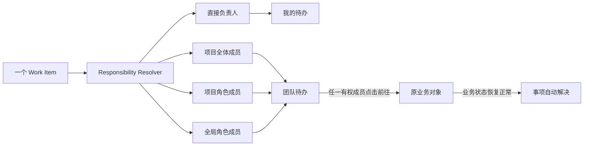

# Project Wing 统一待办筛选后实施提案

日期：2026-08-31

状态：待产品批准后实施

依据：`docs/work-item-exception-catalog.md`

## 1. 提案结论

排除函证中心后，当前发现目录共有 60 项。本提案按照“当前必须存在责任分配路径”的标准重新筛选：

| 结论         | 数量 | 范围                                                   |
| ------------ | ---: | ------------------------------------------------------ |
| 纳入实施     |   51 | EMP 12、项目执行 10、CMP 16、TMS 8、OPS 5              |
| 只展示或合并 |    9 | 复核问题状态合并 2、File Check Warning 4、CMP 1、TMS 2 |

函证中心明确不接入统一异常/待办基础设施。本提案不建立函证 Work Item、函证待办入口、责任选择器或异常统计；现有函证流程和状态展示保持原样。

## 2. 硬性纳入标准

一个异常只有同时满足以下条件才可以产生待办：

1. **持续存在**：异常是可重复判断的业务状态，而不是一次性成功通知或当前请求中的瞬时错误。
2. **责任可解析**：当前数据库和权限模型能够解析到具体用户或明确集合。
3. **关闭可判断**：领域状态能够自动证明恢复正常、取消或被授权豁免。
4. **对象可定位**：存在稳定的业务对象 ID 和结构化操作目标，不依赖持久化页面 URL。
5. **达到注意力阈值**：需要行动或会阻塞流程。普通 Warning 只进入检查报告，不进入待办；检查系统本身无法运行且重试耗尽除外。

以下责任路径都属于“已经有负责人”，不会被视为悬空：

| 责任路径 | 解释 | 示例 |
| --- | --- | --- |
| 具体用户 | 数据库已有唯一用户 ID | 复核问题 `assignedToId`、CMP `picApproverId` |
| 项目全体 | 当前项目全部活跃成员共同负责 | SmartForm 无唯一编制人、项目归档退回 |
| 项目角色 | 当前项目可解析的 Partner、PIC、MIC、编制人或复核人集合 | 归档、签核、职责冲突 |
| 全局角色 | 所有活跃的明确全局角色成员 | `SUPER_ADMIN` 最终归档审核、`FINANCE` 核销 |
| 业务集合 | 已有实体关系能够解析的责任集合 | Engagement PIC/MIC、TMS 审批人 |
| 系统后备责任 | 系统先自动重试，耗尽后有明确用户或角色接管 | 导出失败、连接错误 |

“以后可以新建一个队列”不算现有责任路径。若当前没有任何用户、角色、项目成员集合或业务关系能够承接，则暂缓。

## 3. 集体责任进入“团队待办”

项目全体、项目角色和全局角色共同负责时，数据库仍然只有一个事项，但它不能进入每个成员的“我的待办”。责任解析器把个人责任和集体责任分流：



界面必须显示责任来源：

- “由你负责”；
- “项目全体负责”；
- “项目 PIC/MIC 共同负责”；
- “所有系统管理员负责”；
- “Engagement PIC/MIC 共同负责”。

“团队待办”表达的是“团队中需要有一个人完成”，不是“每个人都要分别完成”。它不进入任何成员的个人待办数量，也不要求用户先认领。成员直接点击“前往”打开原业务对象并完成真实业务动作。

多人同时前往时，继续使用原业务对象已有的版本校验、文件锁、幂等或状态条件更新处理并发；待办层不增加第二套锁。任何一名有权成员完成真实业务动作后，领域状态恢复正常，团队视图自动移除该事项。不能为每个成员复制记录，也不能通过“标记完成”各自关闭。

## 4. 已实施责任模型

一个规范化事项包含一个或多个责任选择器：

```text
WorkItem
  id
  ruleId
  subjectType / subjectId / cycleKey
  domain
  status
  severity / priority / dueAt
  structuredActionTarget

WorkItemResponsibility
  workItemId
  selectorType:
    USER
    PROJECT_ALL_MEMBERS
    PROJECT_ROLE
    PROJECT_IN_CHARGE_ROLE
    GLOBAL_ROLE
    ENGAGEMENT_PIC_MIC
    SYSTEM_THEN
  userId / projectId / roleCode / engagementId
```

数据库约束要求每个活动事项至少存在一个责任选择器。没有责任选择器的事项不能进入 `OPEN`，只能作为规则评估错误记录到系统日志。团队待办不保存认领人；“前往”只是结构化导航动作，不改变事项责任和状态。

## 5. 纳入实施：EMP 12 项

| ID | 责任路径 | 解决依据 |
| --- | --- | --- |
| `EMP-001` | 当前用户 | 系统独立性声明已签署 |
| `EMP-002` | 受邀用户 | 接受、撤销或过期 |
| `EMP-003` | 对应项目成员 | 项目独立性声明已签署或成员退出 |
| `EMP-004` | 有成员管理权限的项目成员集合 | 项目职责恢复一致或成员退出 |
| `EMP-005` | 项目所有者和活跃 Partner 集合 | 项目补齐最低责任结构 |
| `EMP-006` | Engagement PIC/MIC 集合 | EMP 项目创建并绑定，或记录不创建决定 |
| `EMP-007` | 项目全体活跃成员；PIC/MIC 显示主要责任 | 项目提交最终检查、归档或调整截止日 |
| `EMP-008` | 与 `EMP-007` 相同 | 与 `EMP-007` 相同，严重程度升级 |
| `EMP-009` | 所有活跃 `SUPER_ADMIN` | 最终确认归档或退回 |
| `EMP-010` | 项目全体活跃成员；PIC/MIC 显示主要责任 | 修正并重新提交或项目状态改变 |
| `EMP-011` | 归档任务发起人，后备为 `SUPER_ADMIN` | 重试成功、退回或取消 |
| `EMP-012` | 导出任务发起人 | 重试成功、重新创建或取消 |

## 6. 纳入实施：项目执行与 File Check 10 项

| ID | 责任路径 | 解决依据 |
| --- | --- | --- |
| `PRJ-001` | 附件/底稿编制人；没有时项目全体 | 有效编制签核 |
| `PRJ-002` | 附件/底稿复核人；没有时项目全体 | 有效复核签核 |
| `PRJ-003` | 复核人；没有时项目全体 | 重新形成有效签核顺序 |
| `PRJ-004` | 项目 PIC/MIC/Partner 集合 | 更换独立复核人并重新签核或受控豁免 |
| `PRJ-005` | 同一个未 Clear 的 Q 同时投影：所有 `status != CLEARED` 的 Q 始终进入团队待办；提出者在 Q 未 Clear 期间始终看到个人项目待办；`assignedToId` 对应用户仅在 `status=OPEN` 时看到个人项目待办 | `WorkingPaperQuestion.status=CLEARED` |
| `PRJ-008` | 锁持有人；无法解析时项目全体 | Check-in、Release 或受控撤销锁 |
| `PRJ-009` | 项目所有者与活跃 Partner 集合 | 版本冲突裁决完成 |
| `PRJ-010` | 最近保存人或编制人；没有时项目全体 | SmartForm 变为 `COMPLETE` |
| `PRJ-015` | 系统先重试；耗尽后 `SUPER_ADMIN` 与最近修改人 | 检查成功、文件替换或受控豁免 |
| `PRJ-016` | Master 会话所有者；后备为 `SUPER_ADMIN` | 恢复、解决冲突或受控关闭 |

一个 Q 始终只对应一个 `PRJ-005` Work Item，但可以同时出现在团队和个人投影视图中：

- 团队待办：只要未 Clear 就一直存在，Assignment 不会把它从团队公告牌移走；
- 提出者的项目待办：只要未 Clear 就一直存在，因为提出者负责最终确认和 Clear；
- 被分配人的项目待办：仅在 Q 为 `OPEN` 时存在；进入非 `OPEN` 状态后消失，再次 Follow-up/Reopen 为 `OPEN` 时重新出现；
- 如果提出者和被分配人是同一用户，个人列表按 Work Item ID 去重，只显示一次。

Assignment 是注意力与操作权限提示，不是团队可见性的开关。沿用现有回复权限：Q 已指定时只有被分配人和提出者可以回复；其他项目成员仍可在团队待办查看并“前往”，但原业务页面按照既有权限决定可执行动作。

`PRJ-006` 的 replied 状态和原 `PRJ-007` 的无指定回复人状态只是同一事项的状态/投影规则，不单独生产事项。未指定回复人本身不是异常；未 Clear 才是异常。

`PRJ-011` 至 `PRJ-014` 继续由 File Check 检测和展示，但只是 Warning，不生成 Work Item，不影响任何待办数字。

## 7. 纳入实施：CMP 16 项

| ID | 责任路径 | 解决依据 |
| --- | --- | --- |
| `CMP-001` | `draftAssigneeId` | 草稿完成、撤回或取消 |
| `CMP-002` | `submittedById` | 正式提交、重新分派或取消 |
| `CMP-003` | `micApproverId` | MIC 通过或退回 |
| `CMP-004` | `picApproverId` | PIC 通过或退回 |
| `CMP-005` | `itApproverId` | IT 通过或退回 |
| `CMP-006` | 现有 return recipient 解析结果 | 修正并重新提交、重新分派或取消 |
| `CMP-007` | 归档草稿提交人与 Engagement MIC | 提交 PIC 审批或取消 |
| `CMP-008` | Engagement PIC | 批准或退回 |
| `CMP-009` | 原提交人与 Engagement MIC | 修正并重新提交或取消 |
| `CMP-010` | Engagement PIC | 账单批准或退回 |
| `CMP-011` | 账单创建人与 Engagement MIC | 修正后重新提交或删除草稿 |
| `CMP-012` | Engagement PIC/MIC 集合 | 标记发送并保存证据 |
| `CMP-013` | Engagement PIC/MIC 集合 | 付款申报、账单终止或进入催收流程 |
| `CMP-014` | 所有活跃 `FINANCE` | 凭证齐全并成功核销 |
| `CMP-015` | 所有活跃 `FINANCE` | 证据与金额恢复一致或有授权覆盖 |
| `CMP-017` | 系统先重试；耗尽后 `FINANCE` 与 `SUPER_ADMIN` | 汇率刷新成功或录入受控 fallback |

`CMP-016` 不纳入：当前公司身份/关联关系冲突只是同步表单校验，没有持久化异常对象，也没有现有数据治理角色或队列。它不是“有人负责但尚未完成”的持续事项。

## 8. 纳入实施：TMS 8 项

| ID | 责任路径 | 解决依据 |
| --- | --- | --- |
| `TMS-001` | 工时所有者 | 对应半月提交，或人员状态使要求失效 |
| `TMS-002` | 不独立分配；作为 `TMS-001` 的动态详情 | 工作日工时补齐后更新详情；对应半月提交后随父待办消失 |
| `TMS-004` | 工时所有者 | 修改并重新提交 |
| `TMS-005` | 对应 Engagement PIC/MIC 集合 | 批准或退回 |
| `TMS-006` | 对应 Engagement PIC/MIC 集合 | 最终确认、退回或撤销修改 |
| `TMS-007` | 工时行所有者；选中项目后该项目全体成员也有处理路径 | 项目映射状态变为 `LINKED` |
| `TMS-008` | 对应 EMP 项目全体成员；PIC/MIC 显示主要责任 | 项目绑定 Engagement 后系统 reconcile |
| `TMS-009` | Engagement PIC/MIC 集合 | 创建并绑定 EMP 项目 |

不单独实施：

- `TMS-002/003` 是 `TMS-001` 的动态详情或子 finding，不复制待办；
- `TMS-010` 与 `EMP-003` 是同一个独立性条件，TMS 只展示阻塞来源，不再创建第二个事项。

## 9. 纳入实施：OPS 5 项

OPS 待办入口只对 `SUPER_ADMIN` 显示。普通用户即使是故障相关任务的发起人，也只在原工作域或对应设置页看到上下文提示，不会看到 OPS 待办入口。

| ID | 责任路径 | 解决依据 |
| --- | --- | --- |
| `OPS-001` | 所有活跃 `SUPER_ADMIN`；受影响连接所有者只在设置页看到修复提示 | 连接验证成功 |
| `OPS-002` | 所有活跃 `SUPER_ADMIN` | 系统连接验证成功 |
| `OPS-003` | 系统先重试；耗尽后所有活跃 `SUPER_ADMIN`；任务发起人的业务事项留在原工作域 | 重试成功、取消或修复根因 |
| `OPS-004` | 所有活跃 `SUPER_ADMIN`；会话所有者的处理事项留在项目待办 | 会话恢复、释放或关闭 |
| `OPS-005` | 系统先重试；耗尽后所有活跃 `SUPER_ADMIN` | 预览或检查基础设施恢复 |

## 10. 只展示或合并清单

| 范围 | 数量 | 不单独生产原因 |
| --- | --: | --- |
| `PRJ-006`、`PRJ-007` | 2 | 都是 `PRJ-005` 未关闭复核问题的生命周期/责任路由状态；无指定回复人本身不是异常 |
| `PRJ-011` 至 `PRJ-014` | 4 | 属于 File Check Warning；保留在报告和定位导航中，但不占用待办注意力 |
| `CMP-016` | 1 | 只有同步校验，没有持久化异常对象和现有责任集合 |
| `TMS-003` | 1 | 是父事项中的校验 finding，不应形成重复待办 |
| `TMS-010` | 1 | 与 `EMP-003` 完全相同，必须去重 |

## 11. 查询与界面提案

待办不建立独立业务页面，而是替换各系统原有的收件箱入口，并在页头以下打开右侧侧栏：

```text
EMP 待办 / CMP 待办 / TMS 待办
  当前系统中业务流程已经明确由我负责

项目待办
  当前项目的“我的待办”和“团队待办”
```

“我的待办”按工作域固定使用五个短名称：

- EMP 待办；
- 项目待办；
- CMP 待办；
- TMS 待办；
- OPS 待办，仅 `SUPER_ADMIN` 可见。

不使用“项目进程”作为入口名称。“项目进程”更接近项目状态时间线，不能准确表达需要处理的事项。EMP 待办承载项目整体、成员、独立性与项目生命周期；项目待办承载底稿、附件、SmartForm、复核问题和 File Check 等项目内部执行事项。

项目内只保留一个“项目待办”入口，放入页头圆角快捷栏；存在活动事项时仅显示红色小圆点，不显示数字胶囊。打开后的右侧区域分为“我的待办”和“团队待办”两个页签。“我的待办”仅包含当前项目中处理责任明确落到当前用户的事项；团队事项不能计入任何成员的个人待办。

不存在“未分配”页；如果规则无法生成责任选择器，事项根本不进入生产表，而是作为配置错误报警。

### 项目内双页签、两级团队待办侧栏

现有“注释/Q”底部面板保持不变，继续展示全部 Q，包括已解决历史。团队待办使用新的项目级入口，只展示尚未恢复正常的活动事项，避免把“全部 Q”和“未解决团队事项”混为一谈。

入口显示“项目待办”，打开后使用一个独立、可调整宽度的右侧区域，不覆盖底稿画布。“我的待办”直接显示当前项目的个人事项；“团队待办”再按分类统计与活动事项明细两级切换，不叠加第二层抽屉。

#### 一级：分类统计

一级只回答“当前项目哪类问题最多、哪些会阻断流程”：

| 大类 | 包含规则 | 统计重点 |
| --- | --- | --- |
| 复核问题 | `PRJ-005` | 未 Clear 数、OPEN 数、REPLIED 数 |
| 签核 | `PRJ-001` 至 `PRJ-004` | 缺失签核、顺序异常、职责分离异常 |
| SmartForm | `PRJ-010` | 未完成实例数 |
| 文件与版本 | `PRJ-008`、`PRJ-009`、`PRJ-016` | 锁定、版本冲突、Master 会话异常 |
| 检查异常 | `PRJ-015` | 重试耗尽、无法完成检查的项目数 |

一级统计表建议列为：

```text
大类        未解决    阻断    最早出现       操作
复核问题      8        8     2026/08/17    查看详情
签核          3        3     2026/08/20    查看详情
SmartForm     2        2     2026/08/22    查看详情
文件与版本    1        1     2026/08/28    查看详情
```

同一业务事项只能计入一个大类。File Check 只是规则来源，不能再把同一个 Q、签核或 SmartForm 问题重复统计为“File Check”事项。`PRJ-011` 至 `PRJ-014` 的 Warning 不进入统计。

#### 二级：活动事项明细

点击“查看详情”后，在同一侧栏切换到该大类的活动事项表，顶部提供返回一级、分类名称、搜索和未解决数量。

明细卡片保持紧凑：

| 列 | 含义 |
| --- | --- |
| 待办内容 | 一段完整、可直接理解的事项文字；项目、对象或分配信息需要出现时直接写入该内容 |
| 更新时间 | 最近一次领域状态变化时间 |
| 操作 | 显示“前往”，定位并打开原业务对象 |

卡片不显示规则编号、状态标签、对象标签或引用编号；事项恢复正常后会自动消失，因此无需再显示“是否已解决”。个人待办不显示“负责人”或“被分配人”，因为责任已经蕴含为当前用户。团队待办同样不固定显示这两个字段；Q 存在 `assignedTo` 时，直接在事项内容后追加“（该问题已被分配给 XXX）”，未分配时不显示占位符。创建人、完整路径和审计信息保留在原业务对象中。

每条规则必须直接生成一段完整、通顺、可执行的用户文案，界面不得再机械拼接项目、编号、标题和说明。例如 TMS 使用“您还没有填报 2026 年 8 月下半月的工时，请尽快填报”；项目 Q 使用“文件 A1-1000-F001（Audit Programme）下，主题为‘…’、发起人为 … 的复核问题尚未被关闭，请关注（该问题已被分配给 …）”。项目待办已经处于当前项目上下文，因此不重复项目名称。

“前往”使用结构化操作目标定位原底稿、文件、Q 或设置页，并高亮对应对象。侧栏不复制 Reply、Clear、签核、冲突裁决等业务按钮；用户在原工作界面按现有权限处理，领域状态恢复后一级统计和二级明细自动更新。这样用户确实可以从团队待办直接去消除问题，同时不会产生第二套业务操作实现。

二级表默认只显示活动事项，不提供“已解决”筛选。Q 的完整历史仍在原“注释/Q”面板查看。

## 12. 实施顺序

### 第一批：基础设施与直接责任

- `WorkItem`、`WorkItemResponsibility`、事项事件时间线；
- 责任解析器与数据库非悬空约束；
- 具体用户、项目全体、项目角色、全局角色和 Engagement PIC/MIC 选择器；
- EMP、CMP、TMS、项目视图的统一查询；
- 直接责任事项：邀请、声明、复核问题、CMP 承接审批、TMS 填报/退回/审批。

### 第二批：项目持续检查

- File Check 12 项待办持续投影；`PRJ-011` 至 `PRJ-014` 只保留 Warning 展示；
- 归档截止日与最终审核；
- 团队待办的统一展示、“前往”导航和领域状态同步；
- 项目内“项目待办”和“团队待办”。

### 第三批：CMP 财务与 OPS

- CMP 账单、收款与核销；
- 汇率、邮件连接、系统连接和后台任务失败；
- 自动重试耗尽后的升级规则。

## 13. 验收标准

1. 数据库不能存在没有责任选择器的活动事项。
2. 集体负责事项只有一条记录，只进入团队待办，不计入任何成员的个人待办数量。
3. 用户退出项目或角色变化后，责任解析结果立即变化。
4. 事项只能由领域状态自动解决、取消或受控豁免，不能用“标记已读”关闭。
5. 51 项都有稳定 dedupe key、结构化操作目标和自动关闭判定。
6. EMP、CMP、TMS 分别提供可直接检查的本地 URL。
7. 函证中心不产生任何统一 Work Item，也不新增函证待办入口。
8. OPS 待办入口和数据只对 `SUPER_ADMIN` 可见。
9. 团队事项没有认领流程；任一有权成员可直接“前往”，事项只在原业务状态恢复后自动消失。
10. 未 Clear 的 Q 始终出现在团队待办；提出者始终有个人项目待办；被分配人只在 Q 为 `OPEN` 时有个人项目待办。
11. 原“注释/Q”面板继续展示全部 Q；新的团队待办侧栏只统计和展示活动事项，一级分类与二级明细不得重复计数。

## 14. 实施状态（2026-08-31）

- 51 条纳入规则均由 EMP、项目、CMP、TMS、OPS 领域投影器实现；9 条合并 finding/Warning 通过共享规则目录明确排除。
- `WorkItemRecord`、`WorkItemResponsibility`、`WorkItemEvent` 已加入 Prisma 模型和增量迁移；活动事项缺少责任选择器时由延迟数据库约束拒绝提交。
- 全局协调器按稳定 dedupe key 合并个人、团队和 OPS 投影，记录 `OPENED / UPDATED / REOPENED / RESPONSIBILITY_CHANGED / RESOLVED` 事件，并在领域状态恢复正常后自动解决持久化事项。
- 协调器使用 PostgreSQL advisory transaction lock 支持多实例部署，并按用户、项目分批评估；前端读取仍使用实时领域投影，不因审计持久化暂时不可用而错误隐藏待办。
- EMP、CMP、TMS 使用原收件箱位置的右侧待办抽屉；项目工作台使用带红点的“项目待办”入口及“我的待办 / 团队待办”双页签。
- 卡片仅展示模板句子、更新时间和“前往”；加载失败不会伪装为空列表，侧栏打开时立即刷新，项目侧栏每 10 秒同步活动状态。
- 旧 `/:locale/tasks` 路由仅保留 307 兼容跳转，不存在独立待办页面；函证中心仍不产生统一 Work Item。
